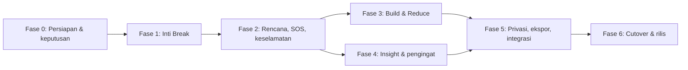

# Rencana Implementasi Fitur Habits v2 — Per Fase sampai Rilis

|                     |                                                                                                 |
| ------------------- | ----------------------------------------------------------------------------------------------- |
| **Versi**     | 1.0                                                                                             |
| **Tanggal**   | 10 Oktober 2026                                                                                 |
| **Dasar**     | `mylife-habits-feature-design.md` v0.1 (target) dan `habits-audit-report.md` (kondisi repo) |
| **Repo**      | `personal-progress-os` (Next.js 16, React 19, Prisma 7, Zod 4, Vitest 4)                      |
| **Pelaksana** | Anda + AI agent (satu langkah per sesi)                                                         |
| **Prinsip**   | Tambah dulu, hapus belakangan. Fitur lama tidak disentuh sampai Fase 6.                         |

---

## 0. Cara Memakai Dokumen Ini

1. Kerjakan **berurutan**: Fase 0 → 6. Jangan loncat.
2. Setiap fase dipecah menjadi **langkah bernomor** (mis. 1.1, 1.2). Satu langkah = satu sesi agent = satu atau beberapa commit kecil.
3. Setiap langkah punya **Definition of Done (DoD)**. Jangan lanjut sebelum DoD terpenuhi dan Anda memeriksanya sendiri.
4. Setiap fase diakhiri **Gerbang QA**. Gerbang yang gagal = fase belum selesai.
5. Di bagian 12 ada **template prompt** untuk agent. Tempel template itu + dokumen rujukan + nomor langkahnya, jangan tulis "terapkan semuanya".

### 0.1 Asumsi yang dipakai (ubah bila keputusan Anda berbeda)

| #   | Keputusan            | Nilai yang dipakai dokumen ini                                                                           |
| --- | -------------------- | -------------------------------------------------------------------------------------------------------- |
| K-1 | Database             | **PostgreSQL saja** untuk Habits, termasuk dev lokal dan CI                                        |
| K-2 | Notifikasi Fase 1–4 | Kanal yang sudah ada: in-app, Telegram, email.**Tanpa Web Push**                                   |
| K-3 | Penamaan API         | Selama transisi:`/api/tracked-habits/...`. Setelah Fase 6 dipindah ke `/api/habits/...`              |
| K-4 | Presisi scheduler    | Tick 5 menit di cron yang sudah ada                                                                      |
| K-5 | Zona waktu           | Default dari`UserPreference.timezone`, bisa dioverride per kebiasaan                                   |
| K-6 | Data lama            | **Dua jalur disiapkan** (A: migrasi, B: reset). Pilihan final dibuat di Fase 0, eksekusi di Fase 6 |
| K-7 | Goal bertipe HABIT   | Tautan opsional`goalId` (Fase 5); belum masuk skor momentum                                            |
| K-8 | AI membaca habit     | **Dilarang** sampai kebijakan privasi siap                                                         |
| K-9 | Produk               | Streak strict, gamifikasi hanya milestone, kategori berisiko dengan layar pengantar                      |

> Jika dev lokal Anda saat ini masih memakai SQLite, memindahkannya ke PostgreSQL (mis. lewat Docker) termasuk dalam Fase 0. Scheduler `SKIP LOCKED`, indeks parsial, array, dan advisory lock tidak tersedia di SQLite.

### 0.2 Ukuran relatif

**S** kecil · **M** sedang · **L** besar. Tidak ada estimasi hari, karena kecepatan tergantung ritme Anda dan agent.

---

## 1. Gambaran Fase dan Ketergantungan



| Fase        | Isi                                                                                          | Ukuran      | Hasil yang bisa dilihat                                           | Sifat migrasi DB                     |
| ----------- | -------------------------------------------------------------------------------------------- | ----------- | ----------------------------------------------------------------- | ------------------------------------ |
| **0** | Backup, branch, keputusan, PostgreSQL, baseline tes                                          | S           | Lingkungan aman                                                   | —                                   |
| **1** | Fungsi murni + tes, skema inti, API, scheduler, UI ringkas                                   | **L** | Check-in harian jam pilihan berjalan, timer, terpeleset, kalender | Aditif                               |
| **2** | Pemicu, jika–maka, SOS, debrief, deteksi kambuh, keselamatan, milestone                     | **L** | Alat saat dorongan datang dan pemulihan setelah slip              | Aditif                               |
| **3** | Build (Tiny Habit), jadwal fleksibel, otomatisitas, mode Reduce, pengganti, hemat uang/waktu | **L** | Siklus lengkap Break + Build                                      | Aditif                               |
| **4** | Insight berbasis aturan, pengingat jendela rawan, refleksi mingguan                          | **M** | Sistem mengenali pola pengguna                                    | Aditif                               |
| **5** | Privasi penuh, enkripsi teks, ekspor/hapus, integrasi Goal/Beranda, a11y, (opsional) offline | **M** | Siap dipakai luas dengan aman                                     | Aditif                               |
| **6** | Migrasi data lama, cutover, hapus kode lama, rilis, pemantauan                               | **M** | Fitur lama digantikan                                             | **Destruktif** (dengan backup) |

---

## 2. Aturan Kerja untuk Agent (berlaku semua fase)

**Wajib**

1. Kerjakan **hanya** langkah yang diminta. Jangan "sekalian" mengerjakan langkah berikutnya.
2. Jangan mengubah, memindahkan, atau menghapus kode fitur lama (`habit.service.ts`, `habit.schema.ts`, `habit.repository.ts`, route `/api/habits/**`, komponen `HabitCard`, `CheckInModal`, `HabitFormModal`, `HabitsManager`) sebelum Fase 6.
3. Migrasi database **hanya aditif** pada Fase 1–5 (tambah tabel/kolom/indeks). Tidak ada `DROP`, `RENAME`, atau `ALTER ... TYPE` pada objek lama.
4. Tulis **tes lebih dulu** atau bersamaan untuk setiap logika baru. Logika waktu/streak harus berupa fungsi murni dengan `Clock` yang dapat disuntik.
5. Semua query/mutasi di-*scope* ke `userId` pengguna yang login. Setiap route baru wajib punya tes IDOR.
6. Dilarang menulis ke log: nama kebiasaan, `note`, `withWhom`, `locationLabel`, isi debrief.
7. Jangan memakai `new Date().getFullYear()/getMonth()/getDate()` untuk logika tanggal. Gunakan `luxon` dengan zona waktu eksplisit.
8. Jangan menambah dependensi selain yang disebut di dokumen ini tanpa izin.
9. Habits **tidak boleh** diekspos ke modul AI (`src/lib/ai/**`, `ai/tools/**`) — lihat K-8.
10. Teks UI memakai bahasa tidak menghakimi (desain §13.2). Tidak ada klaim medis atau mitos durasi (mis. "21 hari", "otak rewiring").

**Format laporan di akhir tiap langkah** (agent wajib memberikan):

- Daftar file yang dibuat/diubah.
- Perintah yang dijalankan (`typecheck`, `lint`, `test`) beserta hasilnya.
- Hal yang **sengaja tidak dikerjakan**.
- Asumsi atau pertanyaan yang perlu keputusan Anda.

### 2.1 Definition of Done global (setiap langkah)

- [ ] `npm run typecheck` bersih
- [ ] `npm run lint` bersih
- [ ] `npm test` lulus (semua tes lama tetap lulus)
- [ ] Tidak ada `any` baru tanpa alasan tertulis
- [ ] Tidak ada perubahan di file fitur lama
- [ ] Route baru punya validasi Zod, `requireUserId`, dan tes IDOR
- [ ] Tidak ada data sensitif di log

---

## 3. Konvensi Teknis

### 3.1 Penamaan dan struktur

Karena model `Habit` lama masih ada sampai Fase 6, model inti baru bernama **`TrackedHabit`** (di desain disebut `habits`). Setelah Fase 6 boleh di-*rename*.

```
src/
  lib/habits/                # fungsi murni, tanpa I/O, tanpa Prisma
    clock.ts                 # interface Clock + SystemClock + FakeClock (untuk tes)
    window.ts                # WindowCalculator
    streak.ts                # StreakEngine (computeStats)
    relapse.ts               # RelapseDetector
    status.ts                # penentuan status check-in
    reduce.ts                # dailyLimit (Fase 3)
    insights/                # aturan insight (Fase 4)
    constants.ts
  services/habits/           # use case + transaksi
    habit-v2.service.ts
    event.service.ts
    checkin.service.ts
    stats.service.ts
    scheduler.service.ts
  repositories/habits/       # akses Prisma/raw SQL (verifikasi lokasi repository yang sudah ada)
  schemas/habits/            # Zod
  app/api/tracked-habits/    # route baru
  components/habits-v2/      # UI baru
tests/habits/                # tes baru
```

> Verifikasi dulu lokasi folder `repositories`, `schemas`, `components` yang dipakai repo saat ini, lalu ikuti polanya. Jika berbeda dari rencana di atas, ikuti pola repo, bukan rencana ini.

### 3.2 Aturan teknis

- **ID**: `cuid()` (konsisten dengan model lain).
- **Waktu**: kolom `DateTime @db.Timestamptz(3)`; jam check-in disimpan sebagai `String` "HH:mm" + `CHECK` regex.
- **Zona waktu**: nama IANA (`Asia/Jakarta`), divalidasi lewat `luxon` (`IANAZone.isValidZone`).
- **Validasi**: Zod 4 untuk semua input.
- **Respons API**: ikuti bentuk respons yang sudah dipakai route lain (`{ success, ... }`), tambah `error.code` (`VALIDATION_ERROR`, `NOT_FOUND`, `FORBIDDEN`, `CONFLICT`, `RATE_LIMITED`).
- **Transaksi**: `prisma.$transaction(async tx => …)` interaktif untuk penulisan event + stats.
- **Raw SQL**: hanya untuk `FOR UPDATE SKIP LOCKED` dan `pg_advisory_xact_lock` (lewat `tx.$queryRaw`/`$executeRaw`).
- **Constraint/indeks khusus**: file SQL migrasi manual (ikuti pola `scripts/setup-db-constraints.ts`).
- **Feature flag**: `HABITS_V2` (env). Bila mati, UI `/habits` tetap menampilkan fitur lama.

---

## 4. FASE 0 — Persiapan dan Keputusan  *(S)*

**Tujuan:** memastikan pekerjaan aman, bisa dibatalkan, dan keputusan penting sudah diambil sebelum satu baris kode baru ditulis.

| Langkah       | Tugas                                                                                                                                                                      | DoD                                                                            |
| ------------- | -------------------------------------------------------------------------------------------------------------------------------------------------------------------------- | ------------------------------------------------------------------------------ |
| **0.1** | Buat branch`feature/habits-v2` dari branch utama yang stabil                                                                                                             | Branch ada; CI branch utama hijau                                              |
| **0.2** | **Backup database** (dump penuh) dan simpan di luar repo                                                                                                             | File dump bisa dipulihkan di database kosong (uji sekali)                      |
| **0.3** | Ekspor data habits lama ke JSON:`Habit`, `HabitLog`, `HabitStreak`, `HabitPhase`, `HabitTask`                                                                    | File JSON tersimpan; jumlah baris dicatat                                      |
| **0.4** | **Putuskan K-6**: cek apakah ada data habits milik pengguna lain. Hanya data uji → jalur B (reset). Ada pengguna nyata → jalur A (migrasi)                         | Keputusan tertulis di bagian 14 dokumen ini                                    |
| **0.5** | **Putuskan K-1**: pastikan dev lokal, CI (`.github/workflows/ci.yml`), dan `tests/test-db.ts` memakai PostgreSQL. Cek `DATABASE_URL` dan `src/lib/prisma.ts` | `npm test` lulus di PostgreSQL; kontainer PostgreSQL untuk CI terkonfigurasi |
| **0.6** | Catat baseline: hasil`typecheck`, `lint`, `test` saat ini                                                                                                            | Angka baseline tersimpan (agar regresi terlihat)                               |
| **0.7** | Tambah dependensi`luxon` + `@types/luxon`                                                                                                                              | Terpasang; belum dipakai                                                       |
| **0.8** | Tambah env`HABITS_V2=0` di `.env.example` dan dokumentasi                                                                                                              | Env terdokumentasi                                                             |

**Gerbang Fase 0:** backup terverifikasi, K-1 dan K-6 tertulis, baseline hijau, branch siap.

**Rollback:** hapus branch; tidak ada perubahan di produksi.

---

## 5. FASE 1 — Inti Break  *(L)*

**Tujuan:** ide awal Anda berjalan dengan fondasi yang benar: pengguna membuat kebiasaan Break (mode Abstain), sistem membuat check-in harian pada jam pilihan, pengguna menjawab bersih/terpeleset, timer dan streak benar, kalender tampil.

**Cakupan Fase 1 (sengaja sempit):** hanya `kind=BREAK`, `mode=ABSTAIN`. Mode Reduce dan Build ditolak API dengan `422 NOT_SUPPORTED_YET`.

### Langkah 1.1 — Fungsi murni + tes  *(M)*

Tidak menyentuh DB, API, atau UI.

**Buat:** `src/lib/habits/{clock,window,streak,relapse,status,constants}.ts` dan `tests/habits/*.test.ts`.

**Spesifikasi:**

- `Clock { now(): Date }`; `FakeClock` untuk tes.
- `WindowCalculator`
  - `nextCheckinAfter(t, tz, localTime)`: kemunculan berikutnya `localTime` di zona `tz` setelah `t` (aman DST; bila jam tidak ada/ganda → kejadian valid pertama sesudahnya).
  - `periodDate(windowEnd, tz)` = tanggal lokal dari `windowEnd − 12 jam` (desain §8.1).
  - `buildWindows(habit, from, to)` untuk *catch-up* (maks. 14).
- `status.ts`: `initialStatus(windowEvents)` → `LAPSED` bila ada `LAPSE`, selain itu `PENDING`; `resolveStatus(answer, windowEvents, gracePassed)` sesuai desain §8.2.
- `StreakEngine.computeStats(checkins, events, habit, now)` sesuai definisi metrik §8.3: `currentStreakDays`, `longestStreakDays`, `confirmedCleanDays`, `cleanRate30d`, `lastLapseAt`, `totalLapses`, `urgesResisted`. Jendela `PENDING` tidak dihitung dan tidak memutus.
- `RelapseDetector.detect(checkins, rule, now)`.

**Tes minimal (Vitest, tanpa DB):** T-01, T-03, T-04, T-05, T-06, T-07, T-08, T-09, T-10, T-17 (versi unit), serta:

- `RelapseDetector`: tepat pada ambang (3 `LAPSED` dalam 7 hari), satu di bawah ambang, dan `LAPSED` di luar jendela.
- `current ≤ longest` (property test).
- Menghitung ulang dari nol = hasil inkremental.
- `periodDate` untuk 06:00 dan 20:00 (contoh desain §8.1).
- Zona `Asia/Jakarta`, `Asia/Makassar`, dan satu zona ber-DST (mis. `America/New_York`) pada tanggal peralihan.

**DoD:** semua tes lulus; cakupan fungsi murni ≥ 90% (cek manual); tidak ada import Prisma di `src/lib/habits/`.

### Langkah 1.2 — Skema Prisma + migrasi  *(M)*

**Ubah:** `prisma/schema.prisma` (hanya menambah), tambah file migrasi + SQL constraint. Naikkan `SCHEMA_VERSION` di `src/lib/prisma.ts`. Jalankan `prisma generate`.

**Skema Fase 1:**

```prisma
enum HabitKind        { BREAK BUILD }
enum HabitMode        { ABSTAIN REDUCE }
enum HabitStatus      { ACTIVE PAUSED ARCHIVED }
enum HabitStage       { CONTEMPLATION PREPARATION ACTION MAINTENANCE }
enum HabitEventType   { URGE LAPSE OCCURRENCE COMPLETION SKIP }
enum HabitCheckinStatus {
  PENDING CLEAN LAPSED WITHIN_LIMIT OVER_LIMIT DONE SKIPPED MISSED UNCONFIRMED
}

model TrackedHabit {
  id                 String      @id @default(cuid())
  userId             String
  user               User        @relation(fields: [userId], references: [id], onDelete: Cascade)
  areaId             String?
  area               Area?       @relation(fields: [areaId], references: [id], onDelete: SetNull)
  kind               HabitKind
  mode               HabitMode?
  name               String
  displayAlias       String?
  category           String?
  status             HabitStatus @default(ACTIVE)
  stage              HabitStage  @default(PREPARATION)
  identityStatement  String?
  timezone           String
  checkinLocalTime   String                       // "HH:mm"
  startedAt          DateTime    @db.Timestamptz(3)
  currentWindowStart DateTime    @db.Timestamptz(3)
  nextCheckinAt      DateTime?   @db.Timestamptz(3)
  privacyLevel       Int         @default(1)
  createdAt          DateTime    @default(now()) @db.Timestamptz(3)
  updatedAt          DateTime    @updatedAt @db.Timestamptz(3)
  archivedAt         DateTime?   @db.Timestamptz(3)

  breakProfile HabitBreakProfile?
  events       HabitEvent[]
  checkins     HabitCheckin[]
  stats        HabitStats?
  outbox       HabitNotificationOutbox[]

  @@index([userId, status])
}

model HabitBreakProfile {
  habitId              String  @id
  habit                TrackedHabit @relation(fields: [habitId], references: [id], onDelete: Cascade)
  whyReasons           Json    @default("[]")
  futureSelfNote       String?
  rewardAnalysis       Json    @default("{}")
  baselinePerDay       Decimal? @db.Decimal(8, 2)
  costPerOccurrence    Decimal? @db.Decimal(12, 2)
  currency             String   @default("IDR")
  minutesPerOccurrence Int?
  reduceDailyLimit     Int?
  reduceStepPercent    Int?
  reduceStepEveryDays  Int?
  relapseLapseCount    Int     @default(3)
  relapseWindowDays    Int     @default(7)
  highRiskCategory     Boolean @default(false)
  safetyAckAt          DateTime? @db.Timestamptz(3)
  environmentChecklist Json    @default("[]")
}

model HabitEvent {
  id              String         @id @default(cuid())
  habitId         String
  habit           TrackedHabit   @relation(fields: [habitId], references: [id], onDelete: Cascade)
  userId          String
  user            User           @relation(fields: [userId], references: [id], onDelete: Cascade)
  type            HabitEventType
  occurredAt      DateTime       @db.Timestamptz(3)
  loggedAt        DateTime       @default(now()) @db.Timestamptz(3)
  quantity        Decimal        @default(1) @db.Decimal(8, 2)
  intensityBefore Int?
  intensityAfter  Int?
  outcome         String?        // RESISTED | GAVE_IN
  severity        String?        // SLIP | RELAPSE
  mood            Int?
  halt            String[]       @default([])
  locationLabel   String?
  withWhom        String?
  note            String?
  meta            Json           @default("{}")
  source          String         @default("APP")   // APP | CHECKIN | SOS | BACKFILL
  idempotencyKey  String?
  deletedAt       DateTime?      @db.Timestamptz(3)

  @@unique([userId, idempotencyKey])
  @@index([habitId, occurredAt(sort: Desc)])
}

model HabitCheckin {
  id             String             @id @default(cuid())
  habitId        String
  habit          TrackedHabit       @relation(fields: [habitId], references: [id], onDelete: Cascade)
  windowStart    DateTime           @db.Timestamptz(3)
  windowEnd      DateTime           @db.Timestamptz(3)
  periodDate     DateTime           @db.Date
  status         HabitCheckinStatus @default(PENDING)
  quantity       Decimal?           @db.Decimal(8, 2)
  mood           Int?
  note           String?
  notifiedAt     DateTime?          @db.Timestamptz(3)
  respondedAt    DateTime?          @db.Timestamptz(3)
  responseSource String?            // LIVE | BACKFILL | AUTO

  @@unique([habitId, periodDate])
  @@index([habitId, windowEnd(sort: Desc)])
}

model HabitStats {
  habitId            String   @id
  habit              TrackedHabit @relation(fields: [habitId], references: [id], onDelete: Cascade)
  lastLapseAt        DateTime? @db.Timestamptz(3)
  currentStreakDays  Int      @default(0)
  longestStreakDays  Int      @default(0)
  confirmedCleanDays Int      @default(0)
  totalLapses        Int      @default(0)
  urgesResisted      Int      @default(0)
  cleanRate30d       Decimal? @db.Decimal(5, 2)
  relapsePattern     Boolean  @default(false)
  recomputedAt       DateTime @default(now()) @db.Timestamptz(3)
}

model HabitNotificationOutbox {
  id          String   @id @default(cuid())
  userId      String
  user        User     @relation(fields: [userId], references: [id], onDelete: Cascade)
  habitId     String?
  habit       TrackedHabit? @relation(fields: [habitId], references: [id], onDelete: Cascade)
  kind        String
  payload     Json
  scheduledAt DateTime @db.Timestamptz(3)
  status      String   @default("PENDING")   // PENDING | SENT | FAILED | CANCELLED
  attempts    Int      @default(0)
  dedupeKey   String   @unique
  lastError   String?

  @@index([status, scheduledAt])
}
```

Tambahkan relasi balik di `User`: `trackedHabits TrackedHabit[]`, `habitEvents HabitEvent[]`, `habitOutbox HabitNotificationOutbox[]`; di `Area`: `trackedHabits TrackedHabit[]`.

**SQL migrasi manual** (sesuaikan nama tabel/kolom bila repo memakai `@@map`; contoh ini memakai nama default Prisma):

```sql
ALTER TABLE "TrackedHabit" ADD CONSTRAINT chk_th_kind_mode
  CHECK ((kind = 'BREAK' AND mode IS NOT NULL) OR (kind = 'BUILD' AND mode IS NULL));
ALTER TABLE "TrackedHabit" ADD CONSTRAINT chk_th_checkin_time
  CHECK ("checkinLocalTime" ~ '^([01][0-9]|2[0-3]):[0-5][0-9]$');
ALTER TABLE "TrackedHabit" ADD CONSTRAINT chk_th_privacy CHECK ("privacyLevel" BETWEEN 0 AND 2);
CREATE INDEX idx_th_due ON "TrackedHabit" ("nextCheckinAt") WHERE status = 'ACTIVE';

ALTER TABLE "HabitEvent" ADD CONSTRAINT chk_he_qty       CHECK (quantity > 0);
ALTER TABLE "HabitEvent" ADD CONSTRAINT chk_he_intensity CHECK (
  ("intensityBefore" IS NULL OR "intensityBefore" BETWEEN 0 AND 10) AND
  ("intensityAfter"  IS NULL OR "intensityAfter"  BETWEEN 0 AND 10));
ALTER TABLE "HabitEvent" ADD CONSTRAINT chk_he_mood CHECK (mood IS NULL OR mood BETWEEN 1 AND 5);
ALTER TABLE "HabitEvent" ADD CONSTRAINT chk_he_outcome  CHECK (outcome  IS NULL OR outcome  IN ('RESISTED','GAVE_IN'));
ALTER TABLE "HabitEvent" ADD CONSTRAINT chk_he_severity CHECK (severity IS NULL OR severity IN ('SLIP','RELAPSE'));
CREATE INDEX idx_he_habit_time ON "HabitEvent" ("habitId", "occurredAt" DESC) WHERE "deletedAt" IS NULL;

ALTER TABLE "HabitCheckin" ADD CONSTRAINT chk_hc_window CHECK ("windowEnd" > "windowStart");
CREATE INDEX idx_hc_pending ON "HabitCheckin" ("habitId", "windowEnd" DESC) WHERE status = 'PENDING';

CREATE INDEX idx_hob_pending ON "HabitNotificationOutbox" ("scheduledAt") WHERE status = 'PENDING';
```

> `UNIQUE ("userId","idempotencyKey")` mengizinkan banyak `NULL` di PostgreSQL, sesuai kebutuhan.

**DoD:** migrasi berjalan di database kosong **dan** di salinan database yang sudah berisi data lama tanpa mengubah tabel lama; `prisma generate` sukses; tes lama lulus; ada tes yang memverifikasi constraint (insert tidak valid ditolak).

### Langkah 1.3 — Repository + service  *(M)*

**Buat:** `repositories/habits/*`, `services/habits/{habit-v2,event,checkin,stats}.service.ts`, `schemas/habits/*`.

**Perilaku:**

- `createHabit(userId, input)`: validasi (Zod), tolak `kind≠BREAK` / `mode≠ABSTAIN` dengan `NOT_SUPPORTED_YET`; hitung `currentWindowStart` = `startedAt`, `nextCheckinAt` = `nextCheckinAfter(startedAt, tz, jam)`; buat `HabitBreakProfile` dan `HabitStats` kosong dalam satu transaksi.
- `logEvent(userId, habitId, input, idempotencyKey?)`: transaksi + `pg_advisory_xact_lock(hashtext(habitId))`; validasi aturan §8.6 (tidak di masa depan, tidak sebelum `startedAt`, batas backfill 7 hari); simpan event; perbarui status check-in jendela terkait (mis. `LAPSED`); panggil `recomputeStats`.
- `respondCheckin(...)`: hanya jendela yang sudah berakhir dan dalam masa tenggang (72 jam); bila ada `LAPSE` di jendela, jawaban "bersih" ditolak (invarian 4).
- `deleteEvent` (soft delete) + `recomputeFrom`.
- `recomputeStats(habitId)`: bangun ulang dari event + check-in memakai `StreakEngine`.
- `getDashboard(userId, habitId)`: baca `HabitStats`, check-in `PENDING`, 90 hari kalender.

**Tes integrasi (PostgreSQL):** T-07, T-08, T-09, T-10, T-13 (idempotensi), T-18 (IDOR), T-22, dan invarian "recompute dari nol = inkremental".

**DoD:** semua tes lulus; tidak ada query tanpa `userId`; tes konkurensi: dua `logEvent` paralel tidak merusak stats.

### Langkah 1.4 — API route  *(M)*

**Buat** di `src/app/api/tracked-habits/`:

| Metode | Path                                       | Fungsi                                                |
| ------ | ------------------------------------------ | ----------------------------------------------------- |
| POST   | `/`                                      | Buat kebiasaan                                        |
| GET    | `/`                                      | Daftar + ringkasan stats                              |
| GET    | `/[id]`                                  | Detail                                                |
| PATCH  | `/[id]`                                  | Ubah nama, jam check-in, alias, privacyLevel          |
| POST   | `/[id]/pause`, `/resume`, `/archive` | Status                                                |
| GET    | `/[id]/dashboard`                        | Dashboard                                             |
| POST   | `/[id]/events`                           | Catat event (`LAPSE` di Fase 1; `URGE` di Fase 2) |
| DELETE | `/[id]/events/[eventId]`                 | Soft delete                                           |
| GET    | `/[id]/calendar?month=YYYY-MM`           | Status per hari                                       |
| GET    | `/pending-checkins`                      | Check-in menunggu lintas kebiasaan                    |
| POST   | `/[id]/checkins/[checkinId]/respond`     | Jawab check-in                                        |

**Aturan:** `requireUserId` di semua route; Zod pada body/query; header `Idempotency-Key` untuk `POST /events`; `PATCH` jam check-in menghitung ulang `nextCheckinAt` dan menyesuaikan jendela berjalan sekali (desain §8.1).

**Tes:** kontrak (kode status dan bentuk error), IDOR untuk setiap route dengan ID milik pengguna lain, validasi masukan (T-22).

**DoD:** semua endpoint punya tes; respons sesuai konvensi API repo; dokumentasi singkat di `docs/` atau komentar kontrak.

### Langkah 1.5 — Scheduler di cron  *(M)*

**Buat:** `services/habits/scheduler.service.ts` dengan `tick(clock)`; **panggil** dari `/api/cron/reminder` yang sudah ada, dibungkus `try/catch` agar kegagalan habit tidak menjatuhkan reminder lama.

**Perilaku (desain §9.3, §12.2):**

1. Dalam satu transaksi, ambil habit jatuh tempo: `SELECT id … WHERE status='ACTIVE' AND "nextCheckinAt" <= $now ORDER BY "nextCheckinAt" LIMIT 200 FOR UPDATE SKIP LOCKED`.
2. Per habit, loop *catch-up* (maks. 14): buat `HabitCheckin` (`INSERT … ON CONFLICT DO NOTHING` pada `(habitId, periodDate)`), status awal dari `initialStatus`, antre notifikasi ke outbox (dedupe `habit:CHECKIN:<periodDate>`), majukan `currentWindowStart` dan `nextCheckinAt`.
3. Hanya jendela terbaru yang dinotifikasi.
4. Pengirim outbox memanggil kanal yang ada (`notification.service`, `external-notification.service`/Telegram/email) dengan **teks netral** bila `privacyLevel ≥ 1`; hormati jam tenang `UserPreference` dan batas harian bersama reminder lain (verifikasi helper di `reminder.service.ts`).
5. `PENDING` yang melewati masa tenggang 72 jam → `UNCONFIRMED`.
6. Log metrik ringkas: jumlah due, jumlah dibuat, lag maksimum (tanpa data sensitif).

**Tes:** T-01, T-02 (tick dua kali / dua worker paralel), T-03 (catch-up), T-04, T-05 (DST), T-06, T-20 (payload netral).

**DoD:** menjalankan `tick` berulang pada data sama tidak menghasilkan duplikat; `NotificationType` baru (`HABIT_CHECKIN`) terdaftar; reminder lama tetap berfungsi (tes regresi).

### Langkah 1.6 — UI ringkas di balik feature flag  *(M)*

**Buat** di `components/habits-v2/`; halaman `/habits` memilih UI baru bila `HABITS_V2=1`.

**Layar Fase 1:**

- **Daftar**: kartu kebiasaan Break (timer live, streak, badge "Check-in menunggu").
- **Wizard ringkas** (3 langkah): nama + kategori → jam check-in + zona waktu (default dari preferensi) + waktu mulai → alasan (min. 1).
- **Dashboard Break**: timer "bersih sejak", streak/terbaik/clean rate, total hari bersih, kalender 90 hari (bersih / terpeleset / belum dikonfirmasi), tombol **Catat terpeleset**, check-in `PENDING` dengan dua tombol (Bersih / Terpeleset).
- **Catat terpeleset (versi awal)**: waktu, kuantitas, severity Slip/Relapse, mood, catatan opsional; layar pasca-catat menampilkan **modal pemulihan** (total hari bersih, streak terbaik) dengan bahasa netral.

**Kriteria UI:** teks mengikuti §13.2 desain; tidak ada warna merah mencolok untuk slip; dapat dioperasikan keyboard; tidak ada klaim medis.

**DoD:** alur end-to-end berjalan manual; tes komponen/E2E untuk "jawab check-in bersih" dan "catat terpeleset"; flag mati = tampilan lama tidak berubah.

### Langkah 1.7 — Skrip migrasi data lama (disiapkan, belum dijalankan)  *(S)*

**Buat:** `scripts/habits-legacy-migrate.ts` dengan mode `--dry-run`.

- **Jalur A:** `Habit(BAD)` → `TrackedHabit(BREAK/ABSTAIN)`; `HabitLog.isSuccess=false` → `HabitEvent LAPSE` (`occurredAt` = tengah hari lokal tanggal log, `source=BACKFILL`); log sukses → `HabitCheckin CLEAN`; `triggerNotes/whyQuit` → `whyReasons`; zona waktu dari `UserPreference`; jam lama = `checkinLocalTime`; hitung ulang `HabitStats`. `Habit(GOOD)` ditunda sampai Fase 3.
- **Jalur B:** hanya ekspor ulang ke JSON.
- Dry-run melaporkan: jumlah baris, selisih streak lama vs hasil hitung ulang.

**DoD:** dry-run pada salinan database berjalan; laporan selisih dibaca dan diterima oleh Anda.

### GERBANG QA FASE 1

- [ ] Semua tes langkah 1.1–1.7 lulus; baseline lama tidak regresi
- [ ] Skenario manual: buat kebiasaan, ubah jam check-in jadi 2 menit ke depan, tunggu tick → notifikasi muncul → jawab "Bersih" → streak benar
- [ ] Skenario manual: terpeleset 23:40 → check-in 06:00 otomatis `LAPSED`, streak 0, streak terbaik tetap
- [ ] Skenario manual: matikan cron 3 hari (simulasi `FakeClock`) → catch-up membuat 3 jendela, 1 notifikasi
- [ ] T-01–T-10, T-13, T-17, T-18, T-20, T-22 lulus
- [ ] Tidak ada data sensitif di log (cek manual dengan memicu semua alur)
- [ ] Flag `HABITS_V2=0` = perilaku lama utuh

**Rollback:** matikan flag; migrasi aditif sehingga tabel baru boleh dibiarkan.

---

## 6. FASE 2 — Rencana, SOS, dan Keselamatan  *(L)*

**Tujuan:** pengguna punya alat saat dorongan datang dan cara pulih setelah terpeleset: pemicu terstruktur, rencana jika–maka, SOS urge surfing, debrief, deteksi pola kambuh, layar keselamatan, milestone.

### Langkah 2.1 — Skema tambahan  *(S)*

Model baru: `Trigger` (`userId` nullable = bawaan), `HabitTrigger`, `CopingPlan`, `HabitEventTrigger`, `HabitMilestone`, `SupportResource`. Seed pustaka pemicu bawaan (kategori `TIME/PLACE/PERSON/EMOTION/PHYSICAL/ACTIVITY/DEVICE/OTHER`, termasuk HALT+B: Hungry, Angry, Lonely, Tired, Bored) lewat `prisma/seed.ts`.
**DoD:** migrasi aditif; seed idempoten (jalan dua kali tanpa duplikat).

### Langkah 2.2 — Pemicu & rencana jika–maka  *(M)*

Endpoint: `/[id]/triggers` (CRUD), `/triggers/library`, `/[id]/coping-plans` (CRUD), `/[id]/coping-plans/[planId]/outcome` (catat dipakai/membantu). Validasi: pemicu kustom milik pengguna; `CopingPlan` hanya merujuk `HabitTrigger` milik habit yang sama.
**Tes:** CRUD, IDOR, hitungan `timesUsed/timesHelped`.

### Langkah 2.3 — SOS dan event `URGE`  *(M)*

- `POST /[id]/events` menerima `URGE` (`intensityBefore/After`, `outcome`, `meta.durationSec`, `meta.tools`, `meta.copingPlanId`).
- `outcome=GAVE_IN` → server membuat `URGE` **dan** `LAPSE` dalam **satu transaksi**, tertaut `meta.relatedEventId`. Hanya `LAPSE` memengaruhi streak.
- UI SOS: tombol tersedia di semua layar kebiasaan (≤ 2 ketukan), 7 langkah desain F-B3, timer penundaan default 10 menit, satu panggilan API di akhir.
  **Tes:** T-12; `URGE/RESISTED` menambah `urgesResisted` tanpa mengubah streak.

### Langkah 2.4 — Debrief & modal pemulihan lengkap  *(M)*

- Debrief 4 pertanyaan berbasis situasi (desain F-B4); `PATCH /[id]/events/[eventId]` menyimpan jawaban ke `meta.debrief` dan menaut pemicu (`HabitEventTrigger`).
- Setelah debrief, tawarkan memperbarui rencana jika–maka.
  **DoD:** debrief bisa dilewati; bahasa sesuai §13.2.

### Langkah 2.5 — Aturan & deteksi kambuh  *(M)*

- Pakai `RelapseDetector` (Fase 1) pada `recomputeStats`; set `HabitStats.relapsePattern`.
- Alur reset rencana (F-B9): tinjau pemicu, perbarui rencana, turunkan target (Abstain→Reduce **ditawarkan, belum aktif sampai Fase 3**), kembali ke tahap Persiapan.
- Tawaran muncul **sekali** per kejadian pola, bukan tiap membuka aplikasi.
  **Tes:** T-11 dan "tawaran tidak berulang".

### Langkah 2.6 — Layar keselamatan & sumber bantuan  *(M)*

- `HabitBreakProfile.highRiskCategory` + `safetyAckAt`; kategori berisiko (zat dengan risiko gejala putus zat, judi, perilaku makan, self-harm) menampilkan **layar pengantar wajib** (desain §14.3) sebelum rencana dibuat.
- `GET /support-resources?country=&category=` membaca tabel `SupportResource`. **Isi data hanya dari sumber yang sudah Anda verifikasi** (`verifiedAt` wajib); jangan menulis nomor dari ingatan.
- Perilaku makan/berat badan: tidak ada target numerik; arahkan ke bantuan profesional.
- Deteksi kata kunci krisis pada catatan: aturan sederhana dan konservatif → tampilkan sumber bantuan; jangan menyimpan hasil deteksi sebagai label diagnosis.
  **Tes:** T-19; tanpa `safetyAckAt` kebiasaan berisiko tinggi tidak dapat diaktifkan.

### Langkah 2.7 — Milestone  *(S)*

`HabitMilestone` (unik `(habitId, code)`): `STREAK_1/3/7/14/30/60/90/180/365`, `FIRST_URGE_RESISTED`, `URGES_RESISTED_10`, `FIRST_DEBRIEF`, `RETURNED_AFTER_SLIP`. Dicatat saat `recomputeStats`; perayaan tampil sekali dan bisa dimatikan. **Tanpa** milestone kesehatan.

### GERBANG QA FASE 2

- [ ] T-11, T-12, T-19 lulus; IDOR untuk semua route baru
- [ ] Skenario manual: SOS berhasil melawan dorongan → hitungan bertambah; SOS berakhir menyerah → `URGE`+`LAPSE`, streak reset sekali
- [ ] Skenario manual: kategori berisiko → layar pengantar tampil dan tidak bisa dilewati
- [ ] Tinjauan bahasa seluruh UI baru (tidak menghakimi, tanpa klaim medis)
- [ ] Data `SupportResource` sudah diverifikasi oleh Anda

**Rollback:** flag; migrasi aditif.

---

## 7. FASE 3 — Build dan Reduce  *(L)*

**Tujuan:** siklus lengkap melepas dan membangun, termasuk kebiasaan yang tidak realistis dihentikan total.

### Langkah 3.1 — Skema Build  *(S)*

Model `HabitBuildProfile` (`anchorText`, `tinyBehavior`, `celebrationText`, `versions` Json, `scheduleType`, `daysOfWeek Int[]`, `timesPerWeek`, `restDays Int[]`, `replacesHabitId` opsional), `AutomaticitySurvey` (`score 1–7`). Tambah `CHECK` untuk `scheduleType`, rentang `score`.

### Langkah 3.2 — Logika Build (fungsi murni + tes)  *(M)*

- `status.ts`: `DONE`/`SKIPPED`/`MISSED` sesuai jadwal (harian, hari tertentu, X kali/minggu, hari istirahat).
- `streak.ts`: `consistency30d`, `resilientStreak` (putus hanya bila 2 jendela terjadwal beruntun `MISSED`), streak ketat.
  **Tes:** T-15, T-16, hari istirahat tidak memutus, jadwal X kali/minggu.

### Langkah 3.3 — API & UI Build  *(M)*

- Wizard Build: perilaku *tiny* → jangkar → perayaan → jadwal → tautan opsional → identitas.
- Event `COMPLETION`/`SKIP`; perayaan singkat (variasi pesan); "jangan lewatkan dua kali".
- Survei otomatisitas tiap 14 hari + kurva. Teks edukasi: rata-rata ±66 hari **dengan rentang lebar 18–254** (bukan 21 hari).
- Jadwal pengingat Build memakai waktu jangkar.

### Langkah 3.4 — Mode Reduce  *(M)*

- `dailyLimit()` (desain §12.6) sebagai fungsi murni; event `OCCURRENCE` dengan `quantity`; status `WITHIN_LIMIT/OVER_LIMIT`.
- Aktifkan opsi "Abstain → Reduce" dari alur kambuh (Fase 2.5) dan "Reduce → Abstain" saat batas 0.
- Lengkapi `HabitStats`: `consistency30d`, `resilientStreak`.
  **Tes:** T-14; pembulatan `dailyLimit` tidak pernah < 0.

### Langkah 3.5 — Pengganti Break ↔ Build  *(S)*

- `replacesHabitId` (Build → Break) dan `CopingPlan.replacementHabitId`; di SOS, kebiasaan pengganti muncul sebagai opsi aksi dan penyelesaiannya tercatat.

### Langkah 3.6 — Hemat uang & waktu  *(S)*

- `moneySavedEst` dan `minutesSavedEst` (desain §8.3) di `HabitStats`; label **"perkiraan"** di UI; sembunyikan bila baseline kosong.

### Langkah 3.7 — Migrasi kebiasaan GOOD lama (jalur A saja)  *(S)*

Perluas `habits-legacy-migrate.ts`: `Habit(GOOD)` → `TrackedHabit(BUILD)`; log sukses → `COMPLETION`; dry-run.

### GERBANG QA FASE 3

- [ ] T-14, T-15, T-16 lulus; tes regresi Fase 1–2 tetap hijau
- [ ] Skenario manual Build: lewati 1 hari → streak tahan banting tetap; lewati 2 hari → putus
- [ ] Skenario manual Reduce: lampaui batas → `OVER_LIMIT`, bukan "terpeleset"
- [ ] Tidak ada teks "21 hari" di mana pun (`grep`)

---

## 8. FASE 4 — Insight dan Pengingat  *(M)*

**Tujuan:** sistem mulai mengenali pola pengguna dengan aturan yang bisa dijelaskan.

### Langkah 4.1 — Mesin insight (fungsi murni + tes)  *(M)*

`src/lib/habits/insights/`: `riskWindows`, `riskDays`, `topTriggers`, `haltShare`, `moodCorrelation`, `urgeDuration`, `planEffectiveness`, `earlyBurstEducation`.

- **Ambang data minimum**: ≥ 14 hari dan ≥ 10 event relevan; di bawah itu tidak tampil.
- Jendela rawan: bin `(hari, jam)` dari `URGE+LAPSE` 60 hari terakhir, bobot peluruhan eksponensial `0.5^(umur/30)`, ambil 3 teratas dengan ≥ 3 kejadian mentah.
- Hasil insight berbentuk `{ kind, text, evidence }` sehingga bisa dijelaskan ("berdasarkan N kejadian").
  **Tes:** data sintetis dengan hasil yang diketahui; di bawah ambang → kosong; korelasi diberi label "korelasi, bukan sebab-akibat".

### Langkah 4.2 — Endpoint & UI insight  *(M)*

`GET /[id]/insights?range=30d|60d|90d`; heatmap jam × hari, pemicu dominan, porsi HALT+B, durasi dorongan, efektivitas rencana.

### Langkah 4.3 — Pengingat  *(M)*

Model `HabitReminder` (`kind`: `CHECKIN`, `EVENING_REFLECTION`, `RISK_WINDOW`, `WEEKLY_REVIEW`, `ANCHOR`; `localTime`, `daysOfWeek`, `nextFireAt`). Scheduler memproses reminder jatuh tempo dengan pola yang sama (`SKIP LOCKED`, dedupe).

- Pengingat jendela rawan 15–30 menit sebelum bin teratas.
- Aturan global: jam tenang, **batas maksimum per hari bersama** reminder lain, mode teks netral.

### Langkah 4.4 — Refleksi mingguan & pesan pengembalian  *(S)*

`HabitReflection` (unik `(habitId, weekStart)`); ringkasan satu layar + satu pertanyaan. Tak ada aktivitas 3 hari → satu pesan hangat, **maksimal 1/minggu**, tanpa rasa bersalah.

### GERBANG QA FASE 4

- [x] Tes insight pada data sintetis lulus; tidak ada insight di bawah ambang
- [x] Batas harian notifikasi (gabungan reminder lama + habit) terbukti lewat tes
- [x] Uji manual: pengingat jendela rawan tidak muncul pada jam tenang
- [x] Setiap insight menampilkan dasar datanya

---

## 9. FASE 5 — Privasi, Ekspor/Hapus, dan Integrasi  *(M)*

**Tujuan:** aman dan lengkap untuk dipakai luas.

### Langkah 5.1 — Privasi penuh  *(M)*

- `privacyLevel`: 0 normal · 1 notifikasi netral · 2 nama samaran (`displayAlias`) di seluruh UI **dan** seluruh kanal (in-app, Telegram, email).
- Enkripsi level aplikasi (AES-256-GCM, kunci dari env `HABITS_ENC_KEY`) untuk `note`, `withWhom`, `locationLabel`, `futureSelfNote`, isi debrief. Siapkan versi kunci agar bisa rotasi.
- **Tes pembersihan log**: jalankan semua alur dengan penangkap log dan pastikan tidak ada nama kebiasaan/isi catatan.
  **DoD:** data terenkripsi di DB (cek langsung); kunci hilang = data tidak terbaca dan aplikasi gagal dengan pesan jelas, bukan crash.

### Langkah 5.2 — Ekspor & hapus permanen  *(M)*

- Tambah habit v2 ke `data-export.service.ts` (kebiasaan, profil, event, check-in, pemicu, rencana, milestone, refleksi).
- Hapus permanen per kebiasaan (`hard=true`) dan saat hapus akun; verifikasi tidak ada sisa (cache/outbox ikut terhapus).
  **Tes:** ekspor memuat semua tabel; hapus meninggalkan 0 baris terkait.

### Langkah 5.3 — Integrasi Goal & Beranda  *(M)*

- `goalId` nullable (`onDelete: SetNull`) pada `TrackedHabit`; tautan opsional dari UI. Putuskan perilaku `GoalType.HABIT` (K-7): tautan opsional, tanpa efek ke skor momentum.
- Widget "check-in menunggu" di beranda/`today` yang membaca `/pending-checkins`; patuhi mode diskret (tanpa nama kebiasaan).
- Pastikan `Insights/Momentum` tidak membaca `HabitEvent`.

### Langkah 5.4 — Penguncian dari AI  *(S)*

Tes statis/otomatis yang memastikan `src/lib/ai/**` dan `ai/tools/**` tidak meng-import repository/service habit v2 (K-8).

### Langkah 5.5 — Aksesibilitas & performa  *(M)*

- Operasi keyboard, pembaca layar, kontras; SOS tidak hanya mengandalkan warna.
- Pemeriksaan performa: dashboard p95 < 300 ms, tulis event p95 < 200 ms, tick dengan 10.000 habit due < 5 detik (uji dengan data sintetis); periksa `EXPLAIN` untuk query due/dashboard.

### Langkah 5.6 — (Opsional) Antrean offline  *(M)*

Antrean event di klien + `Idempotency-Key` (T-21). Dapat ditunda ke setelah rilis bila waktu terbatas.

### GERBANG QA FASE 5

- [x] T-20 lulus; tes IDOR untuk semua route habit v2 lulus
- [x] Ekspor dan hapus terbukti lengkap (cascade 0 orphan row, ekspor terdekripsi transparan)
- [x] Log bersih, data sensitif terenkripsi (AES-256-GCM v1: format)
- [x] AI tidak dapat mengakses habit (static isolation test lulus)
- [x] Integrasi Today dashboard widget check-in & UI kelola/hapus kebiasaan terpasang

---

## 10. FASE 6 — Cutover dan Rilis  *(M)*

**Tujuan:** menggantikan fitur lama dengan aman. **Satu-satunya fase destruktif.**

### Langkah 6.1 — Pembekuan & pemeriksaan akhir  *(S)*

- Rilis ke lingkungan staging dengan data salinan produksi; jalankan seluruh suite tes + skenario manual Fase 1–5.
- Backup baru + uji pemulihan (ulangi 0.2).

### Langkah 6.2 — Migrasi data  *(S–M)*

- Jalur A: jalankan `habits-legacy-migrate.ts` (setelah dry-run terakhir diterima); verifikasi jumlah baris dan sampel pengguna.
- Jalur B: pastikan ekspor JSON tersimpan lalu lanjut.
- Catat hasil di bagian 14.

### Langkah 6.3 — Nyalakan flag bertahap  *(S)*

- `HABITS_V2=1` untuk Anda dahulu → pantau 1–2 siklus check-in nyata (termasuk pergantian hari dan jam 06:00 sebenarnya) → baru untuk semua pengguna.

### Langkah 6.4 — Pembersihan kode lama  *(M)*

Dilakukan **setelah** v2 stabil dan Anda setuju:

1. Hapus route `/api/habits/**` lama, `habit.service.ts`, `habit.schema.ts`, `habit.repository.ts`, `HabitCard`, `CheckInModal`, `HabitFormModal`, `HabitsManager`, `HabitDetailClient`, `updateStreakAfterCheckIn`, `buildMotivationalMessage`.
2. Migrasi destruktif (dengan backup): `DROP` `HabitLog`, `HabitStreak`, `HabitPhase`, `HabitTask`, `Habit` lama dan enum `HabitType`, `HabitDifficulty`.
3. Pindahkan `/api/tracked-habits` → `/api/habits`; (opsional) rename `TrackedHabit` → `Habit` lewat migrasi `RENAME`.
4. Hapus feature flag; naikkan `SCHEMA_VERSION`; `prisma generate`.
5. Perbarui `GoalType.HABIT` dan teks di Insights yang menyebut "catat kebiasaan".

### Langkah 6.5 — Dokumentasi, CI, operasional  *(S)*

- Perbarui `DEPLOY.md`: PostgreSQL wajib, env baru (`HABITS_ENC_KEY`, `CRON_SECRET` tetap), langkah migrasi, jadwal cron yang memanggil endpoint reminder.
- CI: kontainer PostgreSQL, tes habits di pipeline.
- Pemantauan: peringatan bila lag scheduler > 15 menit atau tick gagal beruntun; pantau jumlah check-in `PENDING` yang menumpuk.

### Langkah 6.6 — Tinjauan pascarilis  *(S)*

Setelah 2–4 minggu pemakaian nyata: tinjau metrik (check-in dijawab/dikirim, penggunaan SOS, jawaban terlambat, tingkat `UNCONFIRMED`), umpan balik bahasa, dan daftar perbaikan.

### GERBANG QA FASE 6 (rilis)

- [ ] Staging lulus seluruh tes dan skenario
- [ ] Backup terverifikasi sebelum migrasi destruktif
- [ ] Migrasi data diverifikasi (jumlah & sampel)
- [ ] Dua siklus check-in nyata berjalan di produksi tanpa duplikat/terlewat
- [ ] Kode & tabel lama sudah dihapus, tes tetap hijau
- [ ] Dokumentasi & CI diperbarui

**Rollback sebelum 6.4:** matikan flag. **Setelah 6.4:** pulihkan dari backup + deploy ulang versi sebelumnya (karena itu 6.4 dilakukan paling akhir dan hanya setelah stabil).

---

## 11. Pemetaan Kasus Uji Desain → Fase

| Fase        | Kasus uji (dari desain §15.3)                                                           |
| ----------- | ---------------------------------------------------------------------------------------- |
| **1** | T-01, T-02, T-03, T-04, T-05, T-06, T-07, T-08, T-09, T-10, T-13, T-17, T-18, T-20, T-22 |
| **2** | T-11, T-12, T-19                                                                         |
| **3** | T-14, T-15, T-16                                                                         |
| **5** | T-21 (bila antrean offline dikerjakan), regresi T-20 pada semua kanal                    |

**Invarian yang dites sejak Fase 1** (desain §15.2): idempotensi tick; recompute dari nol = inkremental; ubah jam check-in tidak mengubah riwayat; event `LAPSE` mencegah jawaban "bersih"; tidak ada akses lintas pengguna; `current ≤ longest`; tidak ada `occurredAt` di masa depan.

---

## 12. Template Prompt untuk Agent

### 12.1 Template umum (tempel di awal setiap sesi)

```
Konteks: repo personal-progress-os (Next.js 16, Prisma 7, Zod 4, Vitest 4).
Referensi: mylife-habits-feature-design.md (target), habits-audit-report.md (kondisi repo),
habits-implementation-plan.md (rencana).

Kerjakan HANYA: Fase <N>, Langkah <N.M>.

Aturan:
- Ikuti bagian 2 (Aturan Kerja untuk Agent) dan bagian 3 (Konvensi Teknis) dari habits-implementation-plan.md.
- Jangan mengubah/menghapus kode fitur habits lama. Migrasi hanya aditif.
- Jangan mengerjakan langkah lain "sekalian".
- Tulis tes untuk setiap logika baru. Jalankan typecheck, lint, dan test.
- Jika ada ketidakjelasan atau konflik antara dokumen dan kode repo, berhenti dan tanyakan,
  jangan menebak.

Di akhir laporkan: file yang diubah, hasil perintah (typecheck/lint/test), hal yang sengaja tidak
dikerjakan, dan pertanyaan yang butuh keputusan saya.
```

### 12.2 Prompt langkah Fase 1 (siap tempel setelah template)

**1.1**

```
Langkah 1.1: buat fungsi murni src/lib/habits/{clock,window,streak,relapse,status,constants}.ts dan
tes di tests/habits/. Tanpa Prisma, tanpa DB, tanpa UI. Gunakan luxon dengan zona waktu IANA
eksplisit. Implementasikan WindowCalculator (nextCheckinAfter, periodDate = tanggal lokal dari
windowEnd - 12 jam, buildWindows maks 14), initial/resolveStatus (desain §8.2), StreakEngine
(§8.3, jendela PENDING tidak dihitung dan tidak memutus), RelapseDetector. Tes wajib: T-01, T-03,
T-04, T-05 (zona ber-DST), T-06..T-10, T-17 versi unit, current<=longest, recompute dari nol =
inkremental. Jangan menyentuh file lain.
```

**1.2**

```
Langkah 1.2: tambahkan skema Prisma Fase 1 persis seperti di habits-implementation-plan.md bagian
5 (TrackedHabit, HabitBreakProfile, HabitEvent, HabitCheckin, HabitStats,
HabitNotificationOutbox + enum), relasi balik di User dan Area, migrasi, dan file SQL constraint/
indeks parsial (ikuti pola scripts/setup-db-constraints.ts). Naikkan SCHEMA_VERSION. Jangan
mengubah model lama. Pastikan migrasi berjalan di DB kosong dan di salinan DB berisi data lama.
Tambah tes yang membuktikan constraint menolak data tidak valid.
```

**1.3**

```
Langkah 1.3: buat repository, schema Zod, dan service (habit-v2, event, checkin, stats) sesuai
bagian 5 langkah 1.3. Setiap penulisan event dalam satu transaksi dengan pg_advisory_xact_lock per
habit. Hanya kind=BREAK & mode=ABSTAIN; selain itu NOT_SUPPORTED_YET. Tes integrasi di PostgreSQL:
T-07..T-10, T-13, T-18, T-22, dan tes konkurensi dua logEvent paralel. Semua query wajib ber-scope
userId.
```

**1.4**

```
Langkah 1.4: buat route di src/app/api/tracked-habits/ sesuai tabel di bagian 5 langkah 1.4.
Pakai requireUserId, validasi Zod, bentuk respons mengikuti route lain di repo (tambah error.code),
Idempotency-Key pada POST events. Tes kontrak + IDOR untuk setiap route.
```

**1.5**

```
Langkah 1.5: buat scheduler.service.ts (tick) dan panggil dari /api/cron/reminder dibungkus
try/catch. Ikuti bagian 5 langkah 1.5: FOR UPDATE SKIP LOCKED, INSERT ... ON CONFLICT DO NOTHING,
catch-up maks 14 jendela, outbox dengan dedupeKey, teks netral bila privacyLevel>=1, hormati jam
tenang dan batas harian. Tes: T-01..T-06, T-20, dan tes regresi reminder lama.
```

**1.6**

```
Langkah 1.6: buat UI di src/components/habits-v2/ di balik env HABITS_V2. Daftar, wizard 3 langkah,
dashboard Break, check-in menunggu, catat terpeleset + modal pemulihan. Bahasa tidak menghakimi
(desain §13.2), tanpa klaim medis, tanpa warna merah mencolok untuk slip, dapat dipakai keyboard.
Flag mati = tampilan lama tidak berubah.
```

**1.7**

```
Langkah 1.7: buat scripts/habits-legacy-migrate.ts dengan --dry-run (jalur A untuk Habit BAD,
jalur B ekspor JSON). JANGAN menjalankan migrasi sungguhan; hanya dry-run dan laporkan selisih
streak lama vs hasil hitung ulang.
```

### 12.3 Prompt ringkas Fase 2–6

Gunakan template 12.1 dengan baris langkah berikut:

- **Fase 2:** "Langkah 2.x sesuai bagian 6. SOS dan debrief harus berbahasa tidak menghakimi; `GAVE_IN` membuat `URGE`+`LAPSE` dalam satu transaksi; jangan menulis nomor layanan bantuan dari ingatan, gunakan tabel `SupportResource` yang saya isi."
- **Fase 3:** "Langkah 3.x sesuai bagian 7. Jangan menulis mitos 21 hari; tampilkan rentang 18–254 hari. Logika Build/Reduce harus berupa fungsi murni dengan tes."
- **Fase 4:** "Langkah 4.x sesuai bagian 8. Insight hanya tampil di atas ambang data dan menampilkan dasar datanya; tidak boleh ada klaim sebab-akibat."
- **Fase 5:** "Langkah 5.x sesuai bagian 9. Jangan menulis data sensitif ke log; jangan meng-import habit ke modul AI."
- **Fase 6:** "Langkah 6.x sesuai bagian 10. Jangan menghapus apa pun sebelum saya konfirmasi backup terverifikasi dan v2 stabil."

---

## 13. Risiko Pelaksanaan dan Mitigasi

| Risiko                                        | Dampak                                      | Mitigasi                                                                    |
| --------------------------------------------- | ------------------------------------------- | --------------------------------------------------------------------------- |
| Agent mengerjakan lebih dari yang diminta     | Perubahan sulit diperiksa, fitur lama rusak | Template 12.1, aturan 2, tinjau`git diff` per langkah                     |
| Agent menebak ketika dokumen dan kode berbeda | Skema/perilaku keliru                       | Aturan "berhenti dan tanyakan"                                              |
| Bug zona waktu/DST                            | Check-in salah hari, streak salah           | Fase 1.1 dengan`FakeClock` dan zona ber-DST                               |
| Cron mati                                     | Check-in tidak dibuat                       | Catch-up 14 jendela, peringatan lag, pemantauan                             |
| Notifikasi bocor nama kebiasaan               | Pelanggaran privasi                         | `privacyLevel`, tes T-20 semua kanal, tes log                             |
| Migrasi destruktif salah                      | Kehilangan data                             | Backup terverifikasi, dry-run, Fase 6.4 paling akhir                        |
| Pembengkakan lingkup                          | Tidak selesai                               | Gerbang QA per fase; rilis boleh berhenti di akhir Fase 2 atau 3 bila perlu |
| Data bantuan krisis salah/usang               | Bahaya bagi pengguna                        | Hanya isi terverifikasi,`verifiedAt`, tinjau berkala                      |
| Beban cron dengan banyak habit                | Tick lambat                                 | Batas 200/tick, indeks parsial, uji performa Fase 5                         |

**Titik berhenti yang aman:** produk sudah berguna di akhir **Fase 2** (Break lengkap dengan SOS), jadi bila waktu terbatas, Fase 3–5 bisa diurutkan ulang atau ditunda — kecuali **5.1 (privasi)** dan **5.2 (ekspor/hapus)** yang wajib sebelum rilis ke pengguna lain.

---

## 14. Catatan Keputusan (isi sambil jalan)

| Tanggal | Keputusan                                 | Nilai | Catatan |
| ------- | ----------------------------------------- | ----- | ------- |
|         | K-1 Database                              |       |         |
|         | K-6 Data lama (A/B)                       |       |         |
|         | Hasil dry-run migrasi (selisih streak)    |       |         |
|         | Data`SupportResource` diverifikasi oleh |       |         |
|         | Tanggal backup terakhir sebelum 6.4       |       |         |

---

## 15. Checklist "Selesai" Keseluruhan

- [ ] Fase 0–6 lulus gerbang QA masing-masing
- [ ] Check-in harian berjalan pada jam pilihan pengguna di zona waktunya, tanpa duplikat/terlewat
- [ ] Terpeleset tidak menghapus metrik pemulihan; bahasa tidak menghakimi
- [ ] SOS, pemicu, jika–maka, debrief, deteksi kambuh berfungsi
- [ ] Build (Tiny Habit) dan Reduce berfungsi; tidak ada mitos 21 hari
- [ ] Insight hanya tampil di atas ambang data dan menjelaskan dasarnya
- [ ] Privasi: mode diskret, notifikasi netral, enkripsi teks, log bersih
- [ ] Ekspor dan hapus permanen lengkap
- [ ] AI tidak dapat mengakses habit
- [ ] Kode & tabel lama dihapus; dokumentasi, CI, dan pemantauan diperbarui

---

*Akhir dokumen. Langkah pertama Anda: kerjakan Fase 0 (0.1–0.8), catat K-1 dan K-6 di bagian 14, lalu tempel template 12.1 + prompt langkah 1.1 ke agent.*
