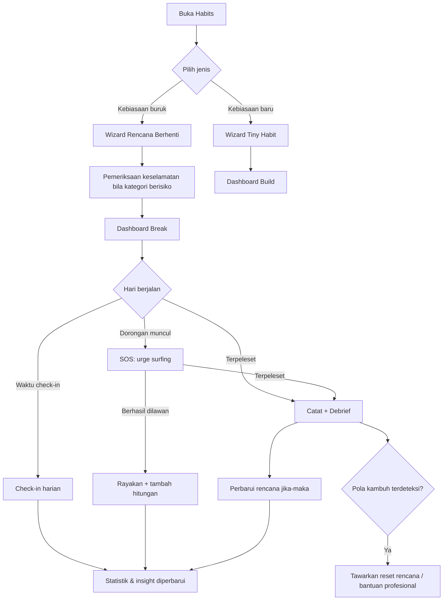
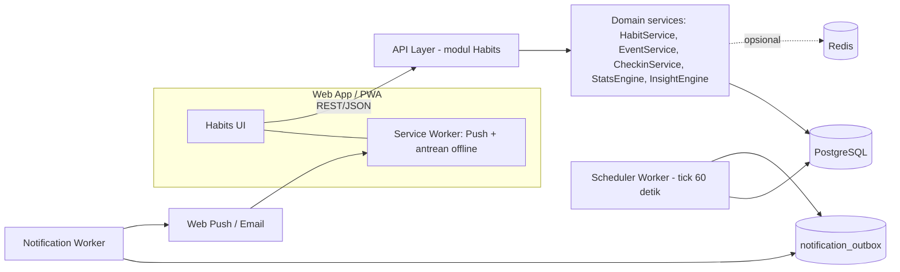
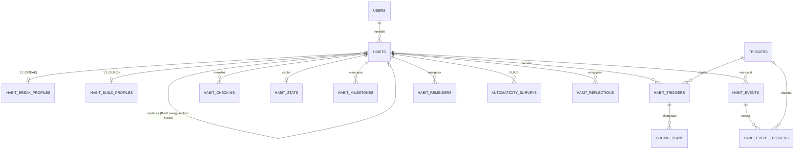

# MyLife — Fitur Habits: Dokumen Desain Arsitektur & Sistem

| | |
|---|---|
| **Versi** | 0.1 (draft untuk review) |
| **Tanggal** | 10 Oktober 2026 |
| **Cakupan** | Fitur *Habits*: melepas kebiasaan buruk (**Break**) dan membangun kebiasaan baru (**Build**) |
| **Peran penyusun** | Software Architect, System Analyst, Database Engineer, API Designer, QA Engineer, Tech Lead |
| **Catatan** | Dokumen ini *agnostik stack*. Di bagian 9 ada rekomendasi default yang bisa disesuaikan dengan stack MyLife yang sudah ada. |

---

## 0. Ringkasan Eksekutif

**Ide awal Anda** (pilih Break/Build → isi nama → pilih jam → sistem mengecek harian jam 06:00 → hitung sudah berapa lama) adalah fondasi yang benar. Masalahnya, penghitung hari saja tidak cukup untuk mengubah perilaku. Riset psikologi (bagian 2) menunjukkan bahwa orang gagal bukan karena kurang pencatatan, melainkan karena: (1) tidak tahu **pemicu** mereka, (2) tidak punya **rencana** saat dorongan datang, (3) **bereaksi buruk terhadap satu kali terpeleset** sehingga berubah menjadi kambuh total.

Maka Break dirancang sebagai **sistem pengubah perilaku**, bukan *counter*:

| Ide awal Anda | Peningkatan dalam desain ini |
|---|---|
| Input nama kebiasaan | **Rencana Berhenti** (wizard): alasan, baseline, pemicu, analisis "imbalan apa yang saya dapat", rencana *jika–maka*, persiapan lingkungan |
| Pilih jam check-in | Jam check-in = **pembatas hari** per kebiasaan, sadar zona waktu, dengan penanganan lupa check-in, *backfill*, dan jam tenang |
| Sistem cek harian | Scheduler berbasis `next_checkin_at` (idempoten, tahan *downtime*), bukan satu cron per kebiasaan |
| Hitung sudah berapa lama | Timer *live* + streak + **clean rate**, total hari bersih, streak terbaik, dorongan yang berhasil dilawan, uang & waktu yang diselamatkan |
| (belum ada) | **Tombol SOS / urge surfing** saat dorongan muncul |
| (belum ada) | **Catatan terpeleset tanpa menghakimi** (lapse vs relapse) + *debrief* yang memperbarui rencana |
| (belum ada) | **Insight pemicu**: jam rawan, hari rawan, HALT, korelasi suasana hati |
| (belum ada) | **Tahap perubahan** (Transtheoretical Model) sebagai kerangka alur, termasuk "daur ulang" setelah kambuh |
| (belum ada) | Mode **Kurangi** (reduce) untuk kebiasaan yang tidak realistis dihentikan total |
| (belum ada) | Privasi (mode diskret, notifikasi netral) dan **pengaman** untuk kategori berisiko |

**Lima keputusan arsitektur terpenting**

1. **Event log append-only** (`habit_events`) adalah sumber kebenaran. Streak dan statistik adalah turunan yang bisa dihitung ulang. Ini membuat edit/hapus/backfill aman.
2. **Check-in = jendela waktu** (`window_start`–`window_end`) yang disimpan eksplisit per baris, sehingga mengganti jam check-in tidak merusak riwayat.
3. **Scheduler berbasis kolom `next_checkin_at`** dengan `FOR UPDATE SKIP LOCKED` dan `UNIQUE(habit_id, period_date)` agar idempoten.
4. **Terpeleset ≠ gagal**: dibedakan *lapse* (satu kali) dan *relapse* (pola kembali), dengan metrik pemulihan yang tidak ikut hilang saat streak direset.
5. **Privasi & keselamatan adalah syarat awal**, bukan fitur tambahan, karena data kebiasaan buruk bisa sangat sensitif.

---

## 1. Konteks, Tujuan, dan Batasan

### 1.1 Tujuan produk
MyLife membantu pengguna menata arah hidup, berhenti menunda, mengelola fokus, dan mewujudkan target. Habits mendukung tujuan itu dengan:
- membantu pengguna **melepas** kebiasaan yang menghambat (menunda, doomscrolling, begadang, kebiasaan merugikan lain);
- membantu pengguna **membangun** kebiasaan pendukung (belajar, olahraga, ibadah, menabung, dll.);
- menghubungkan keduanya: kebiasaan baru dapat menjadi **pengganti** kebiasaan buruk.

### 1.2 Non-tujuan (di luar cakupan)
- Bukan alat medis atau terapi; tidak mendiagnosis, tidak menggantikan tenaga kesehatan.
- Tidak memberi protokol detoksifikasi/penghentian zat.
- Tidak melacak kalori/berat badan (risiko bagi pengguna dengan gangguan makan).
- Fitur sosial/komunitas ditunda ke fase lanjut.

### 1.3 Persona singkat
| Persona | Kebutuhan utama |
|---|---|
| **Penunda kronis** (mahasiswa/pekerja) | Berhenti membuka distraksi saat jam kerja, mulai kebiasaan belajar kecil |
| **Pecandu gawai** | Kurangi (bukan nol) screen time malam hari, ganti dengan membaca |
| **Pengubah kebiasaan serius** (merokok, dll.) | Rencana lengkap, SOS saat craving, pemulihan setelah slip, arahan bantuan profesional |

---

## 2. Ringkasan Riset Psikologi → Implikasi Desain

Ringkasan ini berasal dari pencarian sumber pada 10 Oktober 2026 (daftar sumber di bagian 18). Sebagian sumber adalah ringkasan sekunder/situs populer, jadi setiap temuan diberi **tingkat keyakinan**.

| # | Konsep | Inti temuan | Keyakinan | Implikasi pada sistem |
|---|---|---|---|---|
| 1 | **Habit loop** (isyarat → rutinitas → imbalan) | Kebiasaan dipicu isyarat; memutusnya efektif dengan mengenali isyarat dan **mengganti rutinitas sambil mempertahankan imbalannya**. Kebiasaan lama tetap "terpasang" di otak, jadi yang dibangun adalah jalur pengganti. | Sedang (kerangka konseptual luas, dukungan empiris beragam) | Wizard memuat **analisis imbalan** ("kebiasaan ini memberi saya: pelarian stres/bosan/sosial/stimulasi") lalu menyarankan pengganti yang memenuhi kebutuhan yang sama |
| 2 | **Implementation intentions** (*jika X, maka saya akan Y*) — Gollwitzer | Rencana *jika–maka* yang spesifik meningkatkan keberhasilan dibanding niat yang samar. Sumber sekunder melaporkan peluang 2–3× lebih tinggi. | Sedang–kuat (angka persisnya perlu diverifikasi ke meta-analisis Gollwitzer & Sheeran, 2006, sebelum dipakai sebagai klaim di UI) | Entitas **`coping_plans`**: tiap pemicu utama wajib punya minimal satu rencana jika–maka |
| 3 | **Urge surfing** (Marlatt, bagian dari *Mindfulness-Based Relapse Prevention*) | Dorongan diamati tanpa dilawan atau dituruti, seperti gelombang yang naik lalu surut. MBRP memiliki tinjauan sistematik pada gangguan penggunaan zat dengan hasil yang menjanjikan namun bervariasi. Teknik ini kadang gagal, jadi jangan dijanjikan sebagai obat. | Sedang | **Mode SOS**: intensitas sebelum/sesudah, timer penundaan, panduan mengamati sensasi tubuh, pencatatan hasil |
| 4 | **Competing response** & **perubahan lingkungan** | Melakukan aksi yang tidak kompatibel dengan kebiasaan, dan membuat kebiasaan buruk lebih sulit (friksi) / yang baik lebih mudah. | Sedang | Daftar periksa **persiapan lingkungan**; aksi pengganti di `coping_plans.then_text` |
| 5 | **Extinction burst** | Saat penguatan dihentikan, dorongan bisa **sementara menguat** sebelum mereda. | Sedang (konsep perilaku klasik; sumber yang ditemukan bersifat sekunder) | Insight edukatif: lonjakan dorongan di minggu-minggu awal ≠ kemunduran |
| 6 | **Relapse Prevention Model & Abstinence Violation Effect (AVE)** — Marlatt & Gordon, 1985 | Satu kali terpeleset (*lapse*) menjadi kambuh penuh (*relapse*) sebagian karena reaksi kognitif-emosional: menyalahkan diri ("saya lemah"), rasa bersalah, keyakinan diri turun, lalu "ya sudah sekalian". Atribusi **situasional/sementara** lebih protektif daripada atribusi **internal/permanen**. | Teori berpengaruh; **namun** tinjauan menyebut upaya mengurangi AVE belum konsisten memperbaiki hasil klinis | Alur terpeleset **tanpa menghakimi**, *debrief* berbasis situasi, metrik pemulihan. Jangan menjanjikan bahwa alur ini "terbukti mencegah kambuh" |
| 7 | **Transtheoretical Model / Stages of Change** (Prochaska & DiClemente) | Perubahan adalah proses bertahap dan **siklik**; kambuh sering terjadi dan memicu "daur ulang" ke tahap sebelumnya, bukan akhir perjalanan. Kritik: batas antar tahap kabur dan intervensi yang dicocokkan dengan tahap tidak selalu lebih efektif. | Sedang (bagus sebagai kerangka UX, lemah sebagai prediktor) | Field `stage` per kebiasaan sebagai **kerangka alur UI**, bukan klaim ilmiah; kambuh → tawarkan kembali ke tahap Persiapan |
| 8 | **Pembentukan kebiasaan** — Lally dkk. (UCL, 2009) | Rata-rata (median) ±66 hari hingga otomatis, **rentang 18–254 hari**; angka 21 hari adalah mitos. Melewatkan **satu** kesempatan tidak berpengaruh berarti, tetapi sangat tidak konsisten berakibat gagal. Studi memakai laporan-diri pada 96 orang, diamati 84 hari. | Kuat sebagai bukti terhadap mitos 21 hari; terbatas untuk generalisasi | Jangan menampilkan "21 hari"; tampilkan **kurva otomatisitas** dan aturan **"jangan lewatkan dua kali"**; hari terlewat tidak mereset kebiasaan Build |
| 9 | **Tiny Habits** — BJ Fogg | Perilaku terjadi bila motivasi, kemampuan, dan *prompt* bertemu. Resep: **Setelah [jangkar], saya akan [perilaku kecil], lalu [rayakan]**. Perilaku dibuat sangat kecil; perayaan segera membantu mengikat kebiasaan. Untuk kebiasaan buruk, prinsipnya dibalik: hilangkan *prompt*, tambah friksi. | Sedang (kerangka praktis, bukti RCT terbatas) | Wizard **Build** berformat Jangkar–Perilaku–Perayaan; versi *tiny/standard/stretch* |
| 10 | **HALT** (Hungry, Angry, Lonely, Tired; bonus: Bored) | Kondisi dasar yang lazim dipakai dalam pemulihan sebagai sinyal peringatan dini; ada praktik memakai cek HALT pagi/malam. | Praktik klinis umum; bukti kuantitatif terbatas | Setiap log dorongan/terpeleset punya **penanda HALT+B**; insight "berapa persen kejadian saat lapar/lelah" |
| 11 | **Self-monitoring** | Pencatatan perilaku mengubah kesadaran, dan data pemicu memungkinkan intervensi yang lebih tepat. | Umum dipakai; kekuatan bukti bervariasi | Seluruh desain berpusat pada pencatatan **ringan (≤ 3 ketukan)** agar tahan dipakai |

### 2.1 Pelajaran dari aplikasi sejenis
Deskripsi toko aplikasi (bahan pemasaran, bukan bukti efektivitas) menunjukkan pola fitur yang konsisten: pencatatan *slip* **tanpa menghapus seluruh progres**, log *craving* dengan intensitas/pemicu/catatan, "reset craving 60 detik", penghitung uang/waktu yang dihemat, milestone, tampilan kalender hari bersih vs terpeleset, kebiasaan pengganti, analitik suasana hati, *streak freeze*, dan sebagian menawarkan insight berbasis AI. Beberapa aplikasi sengaja **menghindari streak** supaya tidak memicu rasa malu.

| Fitur pasar | Keputusan |
|---|---|
| Slip tracking tanpa reset total progres | **Adopsi** (metrik pemulihan + streak jujur) |
| Craving log (intensitas, pemicu, catatan) | **Adopsi** (inti SOS & insight) |
| Reset craving 60 detik | **Adopsi** sebagai SOS ringkas |
| Cost/time savings | **Adopsi** (opsional, label "perkiraan") |
| Kalender hari bersih vs slip | **Adopsi** |
| Kebiasaan pengganti | **Adopsi** (relasi Break ↔ Build) |
| *Streak freeze* | **Tidak untuk mode Abstain** (merusak kejujuran data). Untuk Build diganti **hari istirahat** terjadwal |
| XP/badge/level | **Batasi** ke milestone; hindari mekanik yang mendorong rasa bersalah |
| Insight AI | **Tunda**, *opt-in*, setelah privasi teruji. Fase awal pakai aturan yang bisa dijelaskan |
| Local-first/tanpa login | Tidak diadopsi penuh; **mode diskret & enkripsi** menjadi gantinya |

---

## 3. Prinsip Desain (diturunkan dari riset)

1. **Rencana lebih penting daripada penghitung.** Setiap kebiasaan Break harus punya pemicu dan rencana jika–maka sebelum dianggap "siap".
2. **Terpeleset adalah data, bukan dosa.** Bahasa, warna, dan alur tidak menyalahkan.
3. **Catat dalam hitungan detik.** Satu ketukan untuk kejadian; detail menyusul (opsional).
4. **Jujur terhadap data.** Streak direset bila terpeleset; ditemani metrik yang tidak ikut hilang (total hari bersih, streak terbaik, clean rate, dorongan yang dilawan).
5. **Kecil dulu.** Kebiasaan baru dimulai dari versi terkecil yang hampir mustahil gagal.
6. **Insight harus bisa dijelaskan.** Aturan eksplisit dengan ambang data minimum; tidak ada klaim yang tidak didukung data pengguna.
7. **Privasi & keselamatan sejak hari pertama.**

---

## 4. Konsep Produk

### 4.1 Dua jenis kebiasaan
| | **Break** (lepas kebiasaan buruk) | **Build** (bangun kebiasaan baru) |
|---|---|---|
| Tujuan | Mengurangi/menghentikan perilaku | Mengulang perilaku positif sampai otomatis |
| Mode | **Abstain** (nol) atau **Reduce** (kuota harian turun bertahap) | Harian / hari tertentu / X kali per minggu |
| Peristiwa utama | `URGE`, `LAPSE`, `OCCURRENCE` (mode Reduce) | `COMPLETION`, `SKIP` |
| Ukuran sukses | Waktu sejak terakhir terpeleset, clean rate, dorongan dilawan | Konsistensi 30 hari, streak tahan banting, skor otomatisitas |
| Pendamping | Rencana Berhenti, SOS, insight pemicu | Resep Tiny Habit, kurva otomatisitas |

### 4.2 Mode Break
- **Abstain**: target nol. Cocok untuk perilaku yang memang harus dihentikan.
- **Reduce**: target batas harian yang turun bertahap (mis. −10% tiap 7 hari). Melewati batas = hari `OVER_LIMIT`, **bukan** *lapse*. Cocok untuk screen time, gula, kafein, dan sejenisnya.

### 4.3 Tahap perubahan (`stage`)
`CONTEMPLATION` (menimbang) → `PREPARATION` (menyiapkan rencana) → `ACTION` (menjalankan) → `MAINTENANCE` (mempertahankan). Sistem **menyarankan** transisi, pengguna yang mengonfirmasi. Kambuh membuka jalur *daur ulang* (kembali ke `PREPARATION`/`ACTION`).

> Aturan transisi di bagian 8.7 adalah **heuristik produk**, bukan ambang yang berasal dari penelitian. Tuliskan demikian di dokumentasi internal agar tidak disalahartikan.

---

## 5. Perjalanan Pengguna



### 5.1 Wizard "Rencana Berhenti" (Break)
Wizard dibuat **bisa dilewati bertahap**: langkah 1–3 wajib, sisanya dapat diselesaikan kemudian dari tab "Rencana". Kebiasaan dengan rencana belum lengkap diberi lencana "Rencana belum lengkap".

| Langkah | Isi | Wajib? |
|---|---|---|
| 1. Identitas | Nama, kategori (templat), mode Abstain/Reduce, (opsional) nama samaran untuk mode diskret | Ya |
| 2. Mulai | Waktu mulai (sekarang / terjadwal), **jam check-in**, zona waktu | Ya |
| 3. Alasan | 1–3 alasan pribadi + catatan "diri masa depan" | Ya (min. 1) |
| 4. Baseline | Frekuensi per hari, biaya per kejadian, menit per kejadian (untuk penghitung hemat) | Opsional |
| 5. Pemicu | Pilih dari pustaka (waktu, tempat, orang, emosi, HALT+B, aktivitas, perangkat) + pemicu kustom, beri tingkat 1–5 | Disarankan |
| 6. Analisis imbalan | "Kebiasaan ini memberi saya…" (kelegaan stres, pelarian bosan, koneksi sosial, stimulasi, rasa aman) → saran pengganti | Disarankan |
| 7. Rencana jika–maka | Untuk tiap pemicu utama: *Jika …, maka saya akan …* | Disarankan (min. 1 sebelum tahap Action penuh) |
| 8. Lingkungan | Daftar periksa friksi (hapus aplikasi, pindahkan perangkat, hindari rute tertentu) | Opsional |
| 9. Aturan kambuh | "Berapa kali terpeleset dalam berapa hari yang kita anggap pola kambuh?" (default 3 kali / 7 hari) | Otomatis, bisa diubah |
| 10. Pengingat | Check-in utama, refleksi malam (opsional), jendela rawan | Ya (check-in) |

### 5.2 Wizard Build (Tiny Habit)
1. Perilaku target (tulis versi **terkecil**: *tiny*), lalu opsional versi *standard* dan *stretch*.
2. Jangkar: "Setelah saya … (kegiatan yang sudah rutin)".
3. Perayaan: satu aksi/ucapan singkat segera setelahnya.
4. Jadwal: harian / hari tertentu / X kali per minggu + hari istirahat.
5. Tautan opsional: **menggantikan** kebiasaan Break tertentu; terhubung ke **tujuan** MyLife.
6. Pernyataan identitas (opsional): "Saya orang yang …".

---

## 6. Spesifikasi Fitur Break

### F-B1. Check-in Harian
- Jam check-in dipilih pengguna (contoh: 06:00). Jam ini menjadi **pembatas hari** untuk kebiasaan tersebut.
- Pada waktunya, sistem membuat check-in `PENDING` dan mengirim notifikasi: *"Bagaimana 24 jam terakhir? Tidak ada [kebiasaan]?"*.
- Jawaban: **Bersih** / **Terpeleset** (membuka alur debrief) / (mode Reduce) **jumlah kejadian**.
- Aturan konsistensi: bila di dalam jendela sudah ada event `LAPSE`, check-in otomatis `LAPSED` dan pengguna tidak ditanya ulang "bersih atau tidak".
- Pengguna boleh **menjawab terlambat** (mis. sampai 72 jam, ditandai `source=BACKFILL`). Setelahnya status menjadi `UNCONFIRMED`.
- Opsional: **refleksi malam** singkat (suasana hati 1–5, satu kalimat), mengikuti prinsip self-monitoring.

### F-B2. Timer Live & Statistik
- Timer "bersih sejak" (hari:jam:menit) dari `last_lapse_at` (atau `started_at`).
- **Streak (hari)**, **streak terbaik**, **total hari bersih**, **clean rate 30 hari**, **dorongan dilawan**, **jumlah terpeleset**.
- (Opsional) uang & waktu yang dihemat: dihitung dari baseline dan ditandai **"perkiraan"**.
- Milestone: 1, 3, 7, 14, 30, 60, 90, 180, 365 hari **dan** milestone pemulihan: *dorongan pertama dilawan*, *10 dorongan dilawan*, *debrief pertama selesai*, **kembali setelah terpeleset**.
- Kalender: hari bersih / terpeleset / belum dikonfirmasi / di atas batas.

### F-B3. SOS — Urge Surfing
Tombol SOS ada di setiap layar kebiasaan Break dan dapat dibuka ≤ 2 ketukan.

1. Beri nilai intensitas dorongan 0–10.
2. **Namai**: "Ini dorongan, bukan perintah."
3. **Amati** sensasi tubuh (panduan 60–120 detik) + timer penundaan (default 10 menit, dapat diubah).
4. Pilih alat: napas terpandu · aksi pengganti (diambil dari `coping_plans`) · cek HALT+B (minum/makan/istirahat) · hubungi orang kepercayaan · pindah lokasi.
5. Nilai ulang intensitas.
6. Hasil: **mereda** · **masih ada** · **terpeleset** (→ F-B4).
7. Perayaan singkat bila berhasil, dan hitungan "dorongan dilawan" bertambah.

Hanya **satu** panggilan API di akhir (event `URGE` dengan `meta`), agar tahan koneksi buruk.

### F-B4. Catat Terpeleset & Debrief (tanpa menghakimi)
- Pencatatan satu ketukan (waktu default = sekarang, bisa diubah).
- Tanya: **Seberapa besar?** (kuantitas) dan **sekali saja atau kembali ke pola lama?** → `severity` = `SLIP` / `RELAPSE`.
- *Debrief* 4 pertanyaan berbasis **situasi**, bukan karakter:
  1. Apa yang terjadi tepat sebelumnya? (pemicu, tempat, orang)
  2. Kondisi tubuh/perasaan? (HALT+B, suasana hati)
  3. Apa yang berhasil menahan Anda sebelumnya, atau apa yang bisa diubah di situasi itu?
  4. Rencana jika–maka apa yang ingin ditambah/diperbarui?
- Layar pasca-catat menampilkan **modal pemulihan**: total hari bersih, streak terbaik, dorongan yang dilawan, dan kalimat netral yang menegaskan bahwa satu kejadian tidak menghapus progres.
- Bahasa: "terpeleset/slip", bukan "gagal".

### F-B5. Pemicu & Rencana Jika–Maka
- Pustaka pemicu bawaan (+ kustom): `TIME`, `PLACE`, `PERSON`, `EMOTION`, `PHYSICAL` (HALT+B), `ACTIVITY`, `DEVICE`, `OTHER`.
- Tiap kebiasaan memiliki daftar pemicu dengan **tingkat 1–5**.
- `coping_plans`: *Jika [pemicu/kondisi], maka [aksi pengganti]*, dengan hitungan **dipakai** dan **membantu** sehingga efektivitas tiap rencana terlihat.

### F-B6. Insight (berbasis aturan, bisa dijelaskan)
Hanya tampil bila data memadai (default: ≥ 14 hari dan ≥ 10 event relevan).

| Insight | Cara hitung | Tindak lanjut |
|---|---|---|
| **Jam rawan** | Histogram event `URGE`+`LAPSE` per jam × hari (bobot lebih besar untuk 30 hari terakhir) | Notifikasi pencegahan 15–30 menit sebelumnya |
| **Hari rawan** | Rasio kejadian per hari dalam seminggu | Saran rencana khusus akhir pekan, dll. |
| **Pemicu dominan** | Hitung `habit_event_triggers` | Dorong membuat/memperbarui rencana jika–maka |
| **Porsi HALT+B** | % event dengan ≥ 1 penanda | Saran cek HALT pagi/malam |
| **Suasana hati** | Rata-rata mood sebelum terpeleset vs dorongan yang dilawan | Tampilkan sebagai korelasi, bukan sebab-akibat |
| **Durasi dorongan** | Median lama dorongan yang berhasil dilawan | Pesan penyemangat: "biasanya reda dalam ± X menit" |
| **Efektivitas rencana** | `times_helped / times_used` per rencana | Sarankan mengganti rencana yang jarang membantu |
| **Edukasi lonjakan awal** | Dorongan minggu ini > minggu lalu tanpa kenaikan terpeleset | Jelaskan konsep *extinction burst* secara ringkas |

### F-B7. Pengingat Cerdas
- **Jendela rawan**: pengingat singkat sebelum jam rawan (aturan, bukan ML).
- **Refleksi mingguan** (mis. Minggu): ringkasan satu layar + satu pertanyaan.
- **Pengembalian**: bila tidak ada aktivitas 3 hari, kirim satu pesan hangat ("Semuanya baik?"), tanpa rasa bersalah, maksimal sekali per minggu.
- Semua pengingat: **jam tenang**, batas maksimum per hari, mode teks **netral** (tanpa nama kebiasaan di layar kunci).

### F-B8. Mode Reduce
- Setiap kejadian dicatat sebagai `OCCURRENCE` (dengan `quantity`).
- Batas harian turun sesuai jadwal (`reduce_step_percent` setiap `reduce_step_every_days`), selalu dibulatkan wajar dan **tidak pernah di bawah 0**.
- Status hari: `WITHIN_LIMIT` / `OVER_LIMIT`. Tidak ada kata "terpeleset" untuk melewati batas, cukup "melebihi target".
- Opsional: tawarkan beralih ke **Abstain** ketika batas mencapai 0.

### F-B9. Aturan Kambuh & Reset Rencana
- Bila ≥ N *lapse* (di jendela berbeda) dalam M hari → status **pola kambuh**.
- Sistem menawarkan: tinjau pemicu, perbarui rencana, turunkan target (Abstain → Reduce), atau kembali ke tahap Persiapan.
- Bila kategori **berisiko tinggi**, tampilkan ajakan menghubungi tenaga profesional.

### F-B10. Dukungan & Keselamatan
- **Kontak kepercayaan** (disimpan sebagai teks/nomor milik pengguna) tersedia di SOS.
- Halaman **Sumber Bantuan** yang bisa dikonfigurasi per negara. Nomor layanan krisis **tidak** ditulis keras di kode sebelum diverifikasi; simpan di tabel konfigurasi.
- Kategori berisiko (zat dengan risiko putus zat, judi, perilaku makan, dan sejenisnya) menampilkan **layar pengantar** (lihat bagian 14.3).

---

## 7. Spesifikasi Fitur Build

| Kode | Fitur | Deskripsi |
|---|---|---|
| F-U1 | Resep Tiny Habit | Jangkar + perilaku kecil + perayaan; pengingat dipicu waktu jangkar |
| F-U2 | Tiga tingkat | *tiny* / *standard* / *stretch*; hari berat cukup *tiny* dan tetap dihitung berhasil |
| F-U3 | Jadwal fleksibel | Harian, hari tertentu, atau X kali per minggu; **hari istirahat** tidak memutus streak |
| F-U4 | Metrik | **Konsistensi 30 hari**, streak ketat, **streak tahan banting** (putus hanya jika terlewat 2 hari beruntun), total penyelesaian |
| F-U5 | Aturan "jangan lewatkan dua kali" | Setelah satu hari terlewat, pengingat dan salam khusus untuk hari berikutnya |
| F-U6 | **Survei otomatisitas** | Tiap 14 hari: "Seberapa otomatis ini terasa? 1–7"; kurva ditampilkan. Teks edukasi: rata-rata ±66 hari **dengan rentang lebar (18–254)** pada studi tertentu |
| F-U7 | Perayaan | Setelah check-in, tampilkan umpan balik positif singkat (variasi pesan) |
| F-U8 | Kebiasaan pengganti | Tautkan ke satu/lebih kebiasaan Break; di SOS muncul sebagai opsi aksi pengganti dan penyelesaiannya tercatat |
| F-U9 | Identitas | Pernyataan identitas + penghitung **bukti** ("27 kali Anda memilih ini") |
| F-U10 | Integrasi MyLife | Tautan ke **Goal**, sesi **fokus**/tugas; check-in tertunda tampil di beranda MyLife |

---

## 8. Aturan Bisnis Inti

### 8.1 Jendela check-in (window)
- Pengguna memilih `checkin_local_time` dan `timezone` (IANA, mis. `Asia/Jakarta`).
- Satu **jendela** = rentang antara dua kemunculan jam check-in berturut-turut: `[window_start, window_end)`.
- Check-in dibuat pada saat `window_end`.
- **`period_date`** (tanggal yang dilabeli pada kalender) = tanggal lokal dari `window_end − 12 jam`.
  - Contoh: check-in 06:00 pada 11 Okt → `period_date` = 10 Okt (jendela 10 Okt 06:00 – 11 Okt 06:00 sebagian besar jatuh pada 10 Okt).
  - Contoh: check-in 20:00 pada 10 Okt → `period_date` = 10 Okt.
- Mengganti jam check-in berlaku mulai jendela berikutnya; jendela berjalan **dipendek/diperpanjang** sekali, dan `window_start/end` tersimpan di setiap baris sehingga riwayat tidak berubah.
- Event dimasukkan ke jendela berdasarkan `occurred_at`.

### 8.2 Penentuan status check-in
```
BREAK/ABSTAIN : ada LAPSE di jendela → LAPSED
                else jawaban pengguna → CLEAN
                tanpa jawaban dalam masa tenggang → UNCONFIRMED
BREAK/REDUCE  : total quantity ≤ batas hari itu → WITHIN_LIMIT, selain itu OVER_LIMIT
                tanpa jawaban & tanpa event → UNCONFIRMED
BUILD         : ada COMPLETION → DONE ; SKIP terjadwal/hari istirahat → SKIPPED
                tanpa apa pun setelah masa tenggang → MISSED
```
**Masa tenggang jawab** default 72 jam (dapat dikonfigurasi). Check-in `PENDING` yang melewati masa itu berubah ke `UNCONFIRMED` (Break) atau `MISSED` (Build).

### 8.3 Definisi metrik
| Metrik | Definisi |
|---|---|
| `live_clean_duration` | `now − last_lapse_at` (atau `started_at` bila belum pernah) |
| `current_streak_days` | Jumlah jendela selesai berturut-turut (dari yang terbaru) dengan status `CLEAN` atau `UNCONFIRMED`-tanpa-lapse (Abstain) / `WITHIN_LIMIT` (Reduce), berhenti pada `LAPSED`/`OVER_LIMIT`. Jendela `PENDING` belum dihitung dan tidak memutus streak |
| `confirmed_clean_days` | Jumlah jendela berstatus `CLEAN` (dipakai untuk kualitas data) |
| `clean_rate_30d` | `CLEAN / (CLEAN + LAPSED)` pada 30 jendela terakhir (`UNCONFIRMED` dikeluarkan dari penyebut) |
| `longest_streak_days` | Maksimum `current_streak_days` historis |
| `urges_resisted` | Jumlah event `URGE` berhasil `RESISTED` |
| `money_saved_est` | `(baseline_per_day × jendela_dievaluasi − Σquantity kejadian aktual) × cost_per_occurrence`, minimal 0 |
| `minutes_saved_est` | Sama, dengan `minutes_per_occurrence` |
| Build: `consistency_30d` | `DONE / (DONE + MISSED)` pada 30 hari terjadwal terakhir (`SKIPPED` dikeluarkan) |
| Build: `resilient_streak` | Streak yang hanya putus bila 2 jendela terjadwal beruntun `MISSED` |

> Semua angka di atas **dihitung dari event log**, lalu di-cache di `habit_stats` dan dapat dibangun ulang kapan saja.

### 8.4 Lapse vs Relapse
- `LAPSE.severity` ditanyakan saat pencatatan: `SLIP` (sekali) atau `RELAPSE` (kembali ke pola lama).
- Selain jawaban pengguna, sistem mendeteksi **pola kambuh** otomatis bila `jumlah jendela LAPSED dalam relapse_window_days ≥ relapse_lapse_count` (default 3 dalam 7 hari).
- Pola kambuh tidak mengubah angka streak (yang sudah direset karena `LAPSED`), tetapi memicu alur F-B9.

### 8.5 Check-in terlewat
- Tidak ada jawaban ≠ bersih dan ≠ terpeleset: statusnya **belum dikonfirmasi**.
- Pesan pengembalian hangat (maks. 1/minggu). Tidak ada hukuman, tidak ada kata "gagal".

### 8.6 Edit dan hapus event
- `occurred_at` boleh mundur sampai 7 hari (dapat dikonfigurasi), tidak boleh di masa depan (toleransi 5 menit), dan tidak boleh sebelum `started_at`.
- Hapus bersifat *soft delete* (`deleted_at`); setiap edit/hapus memicu **`recomputeFrom(habit, occurred_at)`** untuk jendela terkait dan `habit_stats`.
- Pembatalan (undo) tersedia selama 24 jam.

### 8.7 Transisi tahap (heuristik produk)
| Dari → Ke | Syarat saran |
|---|---|
| `CONTEMPLATION → PREPARATION` | Pengguna memilih "Saya siap menyiapkan rencana" |
| `PREPARATION → ACTION` | Tanggal mulai tercapai **dan** ≥ 1 alasan, ≥ 1 pemicu, ≥ 1 rencana jika–maka |
| `ACTION → MAINTENANCE` | ≥ 90 hari sejak pola kambuh terakhir **dan** `clean_rate_90d ≥ 90%` *(ambang heuristik, bukan hasil penelitian)* |
| `ACTION/MAINTENANCE → PREPARATION` | Pola kambuh terdeteksi → tawarkan daur ulang |

### 8.8 Milestone
Dicatat satu kali pada `habit_milestones` saat tercapai; perayaan ditampilkan sekali dan bisa dimatikan. Milestone kesehatan (mis. "paru-paru mulai pulih") **tidak** dimasukkan kecuali dengan konten bersumber medis terverifikasi per kategori.

---

## 9. Arsitektur Sistem

### 9.1 Diagram komponen


### 9.2 Rekomendasi stack (default, silakan sesuaikan)
| Lapisan | Rekomendasi | Alasan |
|---|---|---|
| Database | **PostgreSQL** | `timestamptz`, `jsonb`, `FOR UPDATE SKIP LOCKED`, indeks parsial, array |
| API | REST + JSON ber-versi (`/api/v1`), validasi skema (mis. Zod/JSON Schema) | Sederhana, mudah diuji |
| Waktu/zona | Library tanggal berbasis IANA (mis. Luxon / `Temporal`) | Menghindari bug zona waktu & DST |
| Job | Worker terpisah dengan *tick* tiap menit; antrean ringan (mis. pg-boss / BullMQ) bila sudah ada Redis | Tidak perlu cron per kebiasaan |
| Notifikasi | **Web Push (VAPID)** + email sebagai cadangan | Aplikasi berbasis web; periksa dukungan Web Push di iOS (perlu PWA terpasang) sebelum mengandalkannya |
| Offline | Antrean event di klien + `Idempotency-Key` | SOS/pencatatan tetap aman saat koneksi buruk |
| Observabilitas | Log terstruktur tanpa isi catatan sensitif; metrik scheduler (lag, jumlah due) | Deteksi dini keterlambatan check-in |

Bila MyLife sudah memiliki modul auth, notifikasi, atau goals, modul Habits **memakai ulang**-nya lewat *adapter* (bagian 9.6), bukan menduplikasi.

### 9.3 Desain scheduler (inti dari ide jam 06:00 Anda)
**Prinsip:** jangan membuat satu cron per kebiasaan. Simpan **kapan check-in berikutnya** (`next_checkin_at`, UTC) di baris kebiasaan, lalu satu worker mengambil yang sudah jatuh tempo.

```mermaid
sequenceDiagram
  participant S as Scheduler (tiap 60 dtk)
  participant D as PostgreSQL
  participant O as notification_outbox
  participant N as Notification Worker
  participant U as Pengguna
  S->>D: BEGIN; SELECT habit WHERE next_checkin_at <= now() AND status='ACTIVE' FOR UPDATE SKIP LOCKED LIMIT 200
  loop tiap habit jatuh tempo (maks. 14 jendela catch-up)
    S->>D: INSERT habit_checkins (window, period_date, status) ON CONFLICT DO NOTHING
    S->>D: Hitung status awal (ada LAPSE di jendela?) 
    S->>O: INSERT outbox (dedupe_key = habit:kind:period_date)
    S->>D: UPDATE habits SET current_window_start = window_end, next_checkin_at = next(tz, local_time)
  end
  S->>D: COMMIT
  N->>O: ambil PENDING, kirim Push/Email
  N-->>U: "Bagaimana 24 jam terakhir?"
  U->>API: POST /checkins/{id}/respond
```

Poin penting:
- **Idempoten**: `UNIQUE (habit_id, period_date)` pada `habit_checkins` dan `UNIQUE dedupe_key` pada outbox. Menjalankan tick dua kali tidak menggandakan apa pun.
- **Tahan downtime**: *catch-up loop* membuat jendela yang terlewat (batas 14) tanpa mengirim 14 notifikasi; hanya yang terbaru yang dinotifikasi.
- **Skalabel horizontal**: `SKIP LOCKED` memungkinkan beberapa worker.
- **Zona waktu & DST**: `next_checkin_at` dihitung dengan library IANA; bila jam lokal tidak ada/ganda karena DST, pilih kejadian valid pertama sesudahnya dan uji kasus tepi.
- **Indeks**: parsial `habits(next_checkin_at) WHERE status='ACTIVE'`.

### 9.4 Pengiriman notifikasi (outbox pattern)
- Tabel `notification_outbox` menyimpan niat kirim; worker mengirim dan menandai `SENT/FAILED` dengan *retry* eksponensial (maks. 5).
- Aturan: jam tenang, batas maksimum per hari, deduplikasi, dan **mode teks netral**.
- Satu pengingat ulang opsional (mis. T+2 jam) bila check-in masih `PENDING`.

### 9.5 Konsistensi & konkurensi
- Penulisan event + pembaruan `habit_stats` dalam **satu transaksi**; kunci per kebiasaan memakai `pg_advisory_xact_lock(hashtext(habit_id::text))`.
- `Idempotency-Key` pada `POST /events` mencegah duplikasi akibat *retry* klien.
- `habit_stats` adalah cache: `recomputeStats(habitId)` membangun ulang dari event + check-in dan dipanggil setelah edit/hapus/backfill.

### 9.6 Titik integrasi dengan MyLife yang sudah ada
| Kebutuhan | Pendekatan |
|---|---|
| Autentikasi/identitas | Pakai `user_id` yang sudah ada; seluruh query **wajib** di-*scope* `user_id` |
| Notifikasi | Adapter `NotificationPort.send(userId, payload)` agar bisa memakai infrastruktur yang ada |
| Goals/Tugas/Fokus | Kolom `goal_id` (nullable) + tautan opsional; check-in tertunda ditampilkan di beranda |
| Zona waktu | Ambil dari profil pengguna sebagai default, bisa dioverride per kebiasaan |

### 9.7 Struktur modul yang disarankan
```
habits/
  domain/        # entitas, aturan (StreakEngine, WindowCalculator, RelapseDetector)
  application/   # use case: CreateHabit, LogEvent, RespondCheckin, StartSOS, GetDashboard
  infrastructure/# repository, scheduler, notification adapter
  api/           # controller, DTO, validasi
  insights/      # aturan insight (murni, tanpa I/O, mudah diuji)
```
Aturan inti (window, streak, deteksi kambuh, insight) dibuat sebagai **fungsi murni** dengan jam yang dapat disuntik (`Clock`), sehingga bisa diuji tanpa database.

---

## 10. Model Data

### 10.1 ERD


### 10.2 DDL (PostgreSQL)
```sql
-- ENUM
CREATE TYPE habit_kind     AS ENUM ('BREAK','BUILD');
CREATE TYPE habit_mode     AS ENUM ('ABSTAIN','REDUCE');           -- hanya BREAK
CREATE TYPE habit_status   AS ENUM ('ACTIVE','PAUSED','ARCHIVED');
CREATE TYPE habit_stage    AS ENUM ('CONTEMPLATION','PREPARATION','ACTION','MAINTENANCE');
CREATE TYPE event_type     AS ENUM ('URGE','LAPSE','OCCURRENCE','COMPLETION','SKIP');
CREATE TYPE checkin_status AS ENUM ('PENDING','CLEAN','LAPSED','WITHIN_LIMIT','OVER_LIMIT',
                                    'DONE','SKIPPED','MISSED','UNCONFIRMED');

-- KEBIASAAN
CREATE TABLE habits (
  id                  UUID PRIMARY KEY DEFAULT gen_random_uuid(),
  user_id             UUID NOT NULL REFERENCES users(id) ON DELETE CASCADE,
  kind                habit_kind   NOT NULL,
  mode                habit_mode,
  name                TEXT NOT NULL CHECK (char_length(name) BETWEEN 1 AND 120),
  display_alias       TEXT,                          -- nama samaran untuk mode diskret
  category            TEXT,                          -- mis. DIGITAL, SUBSTANCE, SLEEP, PRODUCTIVITY
  status              habit_status NOT NULL DEFAULT 'ACTIVE',
  stage               habit_stage  NOT NULL DEFAULT 'PREPARATION',
  identity_statement  TEXT,
  goal_id             UUID,                          -- referensi ke modul Goals MyLife (nullable)
  timezone            TEXT NOT NULL,                 -- IANA, mis. 'Asia/Jakarta'
  checkin_local_time  TIME NOT NULL,                 -- mis. 06:00
  started_at          TIMESTAMPTZ NOT NULL,
  current_window_start TIMESTAMPTZ NOT NULL,
  next_checkin_at     TIMESTAMPTZ,                   -- = window_end berikutnya (UTC)
  privacy_level       SMALLINT NOT NULL DEFAULT 1,  -- 0=normal, 1=notifikasi netral, 2=diskret penuh
  created_at          TIMESTAMPTZ NOT NULL DEFAULT now(),
  updated_at          TIMESTAMPTZ NOT NULL DEFAULT now(),
  archived_at         TIMESTAMPTZ,
  CHECK ((kind = 'BREAK' AND mode IS NOT NULL) OR (kind = 'BUILD' AND mode IS NULL))
);
CREATE INDEX idx_habits_user        ON habits (user_id) WHERE status <> 'ARCHIVED';
CREATE INDEX idx_habits_due         ON habits (next_checkin_at) WHERE status = 'ACTIVE';

-- PROFIL BREAK (1:1)
CREATE TABLE habit_break_profiles (
  habit_id               UUID PRIMARY KEY REFERENCES habits(id) ON DELETE CASCADE,
  why_reasons            JSONB   NOT NULL DEFAULT '[]',   -- ["Tidur lebih cepat", ...]
  future_self_note       TEXT,
  reward_analysis        JSONB   NOT NULL DEFAULT '{}',   -- {"needs":["BOREDOM","STRESS_RELIEF"],"notes":"..."}
  baseline_per_day       NUMERIC(8,2),
  cost_per_occurrence    NUMERIC(12,2),
  currency               CHAR(3) NOT NULL DEFAULT 'IDR',
  minutes_per_occurrence INT,
  reduce_daily_limit     INT,                              -- mode REDUCE
  reduce_step_percent    INT,
  reduce_step_every_days INT,
  relapse_lapse_count    INT NOT NULL DEFAULT 3,
  relapse_window_days    INT NOT NULL DEFAULT 7,
  high_risk_category     BOOLEAN NOT NULL DEFAULT false,
  safety_ack_at          TIMESTAMPTZ,
  environment_checklist  JSONB NOT NULL DEFAULT '[]'
);

-- PROFIL BUILD (1:1)
CREATE TABLE habit_build_profiles (
  habit_id         UUID PRIMARY KEY REFERENCES habits(id) ON DELETE CASCADE,
  anchor_text      TEXT,                                  -- "Setelah saya menyikat gigi"
  tiny_behavior    TEXT NOT NULL,
  celebration_text TEXT,
  versions         JSONB NOT NULL DEFAULT '{}',          -- {"tiny":"..","standard":"..","stretch":".."}
  schedule_type    TEXT NOT NULL DEFAULT 'DAILY' CHECK (schedule_type IN ('DAILY','DAYS_OF_WEEK','TIMES_PER_WEEK')),
  days_of_week     SMALLINT[],                            -- 1=Senin .. 7=Minggu
  times_per_week   SMALLINT,
  rest_days        SMALLINT[],
  replaces_habit_id UUID REFERENCES habits(id) ON DELETE SET NULL
);

-- PUSTAKA PEMICU (user_id NULL = bawaan sistem)
CREATE TABLE triggers (
  id        UUID PRIMARY KEY DEFAULT gen_random_uuid(),
  user_id   UUID REFERENCES users(id) ON DELETE CASCADE,
  category  TEXT NOT NULL CHECK (category IN ('TIME','PLACE','PERSON','EMOTION','PHYSICAL','ACTIVITY','DEVICE','OTHER')),
  code      TEXT,                                          -- mis. HALT_HUNGRY
  label     TEXT NOT NULL
);

CREATE TABLE habit_triggers (
  id          UUID PRIMARY KEY DEFAULT gen_random_uuid(),
  habit_id    UUID NOT NULL REFERENCES habits(id) ON DELETE CASCADE,
  trigger_id  UUID NOT NULL REFERENCES triggers(id),
  severity    SMALLINT NOT NULL DEFAULT 3 CHECK (severity BETWEEN 1 AND 5),
  notes       TEXT,
  UNIQUE (habit_id, trigger_id)
);

-- RENCANA JIKA-MAKA
CREATE TABLE coping_plans (
  id                   UUID PRIMARY KEY DEFAULT gen_random_uuid(),
  habit_id             UUID NOT NULL REFERENCES habits(id) ON DELETE CASCADE,
  habit_trigger_id     UUID REFERENCES habit_triggers(id) ON DELETE SET NULL,
  if_text              TEXT NOT NULL,
  then_text            TEXT NOT NULL,
  replacement_habit_id UUID REFERENCES habits(id) ON DELETE SET NULL,
  times_used           INT NOT NULL DEFAULT 0,
  times_helped         INT NOT NULL DEFAULT 0,
  active               BOOLEAN NOT NULL DEFAULT true,
  created_at           TIMESTAMPTZ NOT NULL DEFAULT now()
);

-- EVENT LOG (sumber kebenaran, append-only secara logika)
CREATE TABLE habit_events (
  id               UUID PRIMARY KEY DEFAULT gen_random_uuid(),
  habit_id         UUID NOT NULL REFERENCES habits(id) ON DELETE CASCADE,
  user_id          UUID NOT NULL REFERENCES users(id) ON DELETE CASCADE,
  type             event_type NOT NULL,
  occurred_at      TIMESTAMPTZ NOT NULL,
  logged_at        TIMESTAMPTZ NOT NULL DEFAULT now(),
  quantity         NUMERIC(8,2) NOT NULL DEFAULT 1 CHECK (quantity > 0),
  intensity_before SMALLINT CHECK (intensity_before BETWEEN 0 AND 10),
  intensity_after  SMALLINT CHECK (intensity_after  BETWEEN 0 AND 10),
  outcome          TEXT CHECK (outcome  IN ('RESISTED','GAVE_IN')),     -- untuk URGE
  severity         TEXT CHECK (severity IN ('SLIP','RELAPSE')),          -- untuk LAPSE
  mood             SMALLINT CHECK (mood BETWEEN 1 AND 5),
  halt             TEXT[] NOT NULL DEFAULT '{}',                        -- HUNGRY, ANGRY, LONELY, TIRED, BORED
  location_label   TEXT,
  with_whom        TEXT,
  note             TEXT,                                                -- dapat dienkripsi di level aplikasi
  meta             JSONB NOT NULL DEFAULT '{}',                         -- SOS: durasi, alat, rencana yang dipakai
  source           TEXT NOT NULL DEFAULT 'APP' CHECK (source IN ('APP','CHECKIN','SOS','BACKFILL')),
  idempotency_key  TEXT,
  deleted_at       TIMESTAMPTZ,
  UNIQUE (user_id, idempotency_key)
);
CREATE INDEX idx_events_habit_time ON habit_events (habit_id, occurred_at DESC) WHERE deleted_at IS NULL;
CREATE INDEX idx_events_habit_type ON habit_events (habit_id, type, occurred_at DESC) WHERE deleted_at IS NULL;

CREATE TABLE habit_event_triggers (
  event_id   UUID NOT NULL REFERENCES habit_events(id) ON DELETE CASCADE,
  trigger_id UUID NOT NULL REFERENCES triggers(id),
  PRIMARY KEY (event_id, trigger_id)
);

-- CHECK-IN (satu per jendela)
CREATE TABLE habit_checkins (
  id                UUID PRIMARY KEY DEFAULT gen_random_uuid(),
  habit_id          UUID NOT NULL REFERENCES habits(id) ON DELETE CASCADE,
  window_start      TIMESTAMPTZ NOT NULL,
  window_end        TIMESTAMPTZ NOT NULL,
  period_date       DATE NOT NULL,                  -- lihat bagian 8.1
  status            checkin_status NOT NULL DEFAULT 'PENDING',
  quantity          NUMERIC(8,2),                   -- mode REDUCE
  mood              SMALLINT CHECK (mood BETWEEN 1 AND 5),
  note              TEXT,
  notified_at       TIMESTAMPTZ,
  responded_at      TIMESTAMPTZ,
  response_source   TEXT CHECK (response_source IN ('LIVE','BACKFILL','AUTO')),
  UNIQUE (habit_id, period_date),
  CHECK (window_end > window_start)
);
CREATE INDEX idx_checkins_pending ON habit_checkins (habit_id, window_end DESC) WHERE status = 'PENDING';

-- CACHE STATISTIK (dapat dibangun ulang)
CREATE TABLE habit_stats (
  habit_id             UUID PRIMARY KEY REFERENCES habits(id) ON DELETE CASCADE,
  last_lapse_at        TIMESTAMPTZ,
  current_streak_days  INT NOT NULL DEFAULT 0,
  longest_streak_days  INT NOT NULL DEFAULT 0,
  confirmed_clean_days INT NOT NULL DEFAULT 0,
  total_lapses         INT NOT NULL DEFAULT 0,
  urges_resisted       INT NOT NULL DEFAULT 0,
  clean_rate_30d       NUMERIC(5,2),
  consistency_30d      NUMERIC(5,2),               -- BUILD
  resilient_streak     INT NOT NULL DEFAULT 0,     -- BUILD
  money_saved_est      NUMERIC(14,2),
  minutes_saved_est    INT,
  relapse_pattern      BOOLEAN NOT NULL DEFAULT false,
  recomputed_at        TIMESTAMPTZ NOT NULL DEFAULT now()
);

CREATE TABLE habit_milestones (
  id          UUID PRIMARY KEY DEFAULT gen_random_uuid(),
  habit_id    UUID NOT NULL REFERENCES habits(id) ON DELETE CASCADE,
  code        TEXT NOT NULL,                       -- STREAK_7, FIRST_URGE_RESISTED, RETURNED_AFTER_SLIP ...
  reached_at  TIMESTAMPTZ NOT NULL DEFAULT now(),
  celebrated  BOOLEAN NOT NULL DEFAULT false,
  UNIQUE (habit_id, code)
);

-- PENGINGAT & OUTBOX
CREATE TABLE habit_reminders (
  id            UUID PRIMARY KEY DEFAULT gen_random_uuid(),
  habit_id      UUID NOT NULL REFERENCES habits(id) ON DELETE CASCADE,
  kind          TEXT NOT NULL CHECK (kind IN ('CHECKIN','EVENING_REFLECTION','RISK_WINDOW','WEEKLY_REVIEW','ANCHOR')),
  local_time    TIME,
  days_of_week  SMALLINT[],
  enabled       BOOLEAN NOT NULL DEFAULT true,
  next_fire_at  TIMESTAMPTZ
);
CREATE INDEX idx_reminders_due ON habit_reminders (next_fire_at) WHERE enabled;

CREATE TABLE notification_outbox (
  id            UUID PRIMARY KEY DEFAULT gen_random_uuid(),
  user_id       UUID NOT NULL REFERENCES users(id) ON DELETE CASCADE,
  habit_id      UUID REFERENCES habits(id) ON DELETE CASCADE,
  kind          TEXT NOT NULL,
  payload       JSONB NOT NULL,
  scheduled_at  TIMESTAMPTZ NOT NULL,
  status        TEXT NOT NULL DEFAULT 'PENDING' CHECK (status IN ('PENDING','SENT','FAILED','CANCELLED')),
  attempts      INT NOT NULL DEFAULT 0,
  dedupe_key    TEXT NOT NULL UNIQUE,
  last_error    TEXT
);
CREATE INDEX idx_outbox_pending ON notification_outbox (scheduled_at) WHERE status = 'PENDING';

-- BUILD: survei otomatisitas & refleksi
CREATE TABLE automaticity_surveys (
  id          UUID PRIMARY KEY DEFAULT gen_random_uuid(),
  habit_id    UUID NOT NULL REFERENCES habits(id) ON DELETE CASCADE,
  answered_at TIMESTAMPTZ NOT NULL DEFAULT now(),
  score       SMALLINT NOT NULL CHECK (score BETWEEN 1 AND 7)
);

CREATE TABLE habit_reflections (
  id          UUID PRIMARY KEY DEFAULT gen_random_uuid(),
  habit_id    UUID NOT NULL REFERENCES habits(id) ON DELETE CASCADE,
  week_start  DATE NOT NULL,
  answers     JSONB NOT NULL DEFAULT '{}',
  UNIQUE (habit_id, week_start)
);

-- SUMBER BANTUAN (dikonfigurasi, jangan menaruh nomor yang belum diverifikasi)
CREATE TABLE support_resources (
  id           UUID PRIMARY KEY DEFAULT gen_random_uuid(),
  country_code CHAR(2) NOT NULL,
  category     TEXT NOT NULL,         -- CRISIS, SUBSTANCE, GAMBLING, MENTAL_HEALTH ...
  label        TEXT NOT NULL,
  contact      TEXT NOT NULL,
  verified_at  DATE NOT NULL,
  active       BOOLEAN NOT NULL DEFAULT true
);
```

### 10.3 Catatan desain data
- **Mengapa satu tabel `habit_events`?** Satu aliran event memudahkan analitik lintas tipe, *recompute*, dan penambahan tipe baru tanpa migrasi besar.
- **Mengapa `habit_stats` dipisah?** Dashboard harus cepat (satu baris), sementara kebenaran tetap di event log.
- **Retensi:** event dipertahankan selama akun aktif; *hard delete* tersedia atas permintaan pengguna (bagian 14).
- **Enkripsi:** kolom teks bebas (`note`, `future_self_note`, `with_whom`, `location_label`) dapat dienkripsi di level aplikasi bila diperlukan.

---

## 11. Desain API

**Konvensi:** basis `/api/v1`; JSON; autentikasi mengikuti MyLife; seluruh sumber daya di-*scope* ke pengguna yang login; waktu dalam ISO-8601 dengan offset; `Idempotency-Key` pada penulisan event.

**Format error**
```json
{ "error": { "code": "VALIDATION_ERROR", "message": "occurredAt tidak boleh di masa depan", "details": [{ "field": "occurredAt" }] } }
```
Kode: `VALIDATION_ERROR` (422), `NOT_FOUND` (404), `FORBIDDEN` (403), `CONFLICT` (409), `RATE_LIMITED` (429).

### 11.1 Daftar endpoint
| Metode | Endpoint | Fungsi |
|---|---|---|
| POST | `/habits` | Buat kebiasaan (Break/Build) beserta rencana (payload wizard) |
| GET | `/habits?kind=&status=` | Daftar kebiasaan + ringkasan statistik |
| GET | `/habits/{id}` | Detail + profil + pemicu + rencana |
| PATCH | `/habits/{id}` | Ubah nama, jam check-in, tahap, privasi, dll. |
| POST | `/habits/{id}/pause` · `/resume` · `/archive` | Siklus status |
| GET | `/habits/{id}/dashboard` | Statistik, timer, milestone, check-in tertunda, insight ringkas |
| POST | `/habits/{id}/events` | Catat `URGE`/`LAPSE`/`OCCURRENCE`/`COMPLETION`/`SKIP` |
| PATCH | `/habits/{id}/events/{eventId}` | Ubah (mis. isi debrief) |
| DELETE | `/habits/{id}/events/{eventId}` | Soft delete (+ recompute) |
| GET | `/habits/{id}/events?from=&to=&type=` | Riwayat |
| GET | `/checkins/pending` | Semua check-in menunggu lintas kebiasaan |
| POST | `/habits/{id}/checkins/{checkinId}/respond` | Jawab check-in |
| GET | `/habits/{id}/calendar?month=YYYY-MM` | Status per hari |
| GET | `/habits/{id}/insights?range=30d` | Insight (heatmap, pemicu, HALT, dll.) |
| GET/POST/PATCH/DELETE | `/habits/{id}/triggers` | Kelola pemicu kebiasaan |
| GET/POST/PATCH/DELETE | `/habits/{id}/coping-plans` | Kelola rencana jika–maka |
| POST | `/habits/{id}/coping-plans/{planId}/outcome` | Catat dipakai/membantu |
| GET | `/triggers/library` | Pustaka pemicu bawaan |
| POST | `/habits/{id}/automaticity` | Kirim skor otomatisitas (Build) |
| GET/PUT | `/habits/{id}/reminders` | Atur pengingat |
| POST | `/habits/{id}/reflections` | Simpan refleksi mingguan |
| GET | `/support-resources?country=ID&category=` | Sumber bantuan terkonfigurasi |
| GET | `/habits/export` · DELETE `/habits/{id}?hard=true` | Ekspor & hapus permanen |

### 11.2 Contoh: membuat kebiasaan Break
`POST /api/v1/habits`
```json
{
  "kind": "BREAK",
  "mode": "ABSTAIN",
  "name": "Doomscrolling malam hari",
  "category": "DIGITAL",
  "timezone": "Asia/Jakarta",
  "checkinLocalTime": "06:00",
  "startedAt": "2026-10-10T13:30:00+07:00",
  "stage": "ACTION",
  "plan": {
    "reasons": ["Tidur lebih cepat", "Fokus lebih baik di pagi hari"],
    "futureSelfNote": "Saya ingin bangun tanpa merasa lelah.",
    "baselinePerDay": 1,
    "minutesPerOccurrence": 90,
    "rewardNeeds": ["BOREDOM", "STRESS_RELIEF"],
    "relapseRule": { "lapseCount": 3, "windowDays": 7 }
  },
  "triggers": [
    { "triggerId": "5b0c…", "severity": 4 },
    { "custom": { "category": "EMOTION", "label": "Bosan setelah selesai kerja" }, "severity": 5 }
  ],
  "copingPlans": [
    { "ifText": "Saya merasa bosan setelah jam 21:00", "thenText": "Taruh HP di luar kamar dan baca 10 halaman" }
  ],
  "privacyLevel": 1
}
```
Respons `201`:
```json
{
  "id": "0f4a…",
  "kind": "BREAK",
  "stage": "ACTION",
  "nextCheckinAt": "2026-10-11T06:00:00+07:00",
  "planCompleteness": { "reasons": true, "triggers": true, "copingPlans": true, "environment": false }
}
```

### 11.3 Contoh: mencatat terpeleset
`POST /api/v1/habits/{id}/events` (header `Idempotency-Key: 7c1d…`)
```json
{
  "type": "LAPSE",
  "occurredAt": "2026-10-12T23:40:00+07:00",
  "quantity": 1,
  "severity": "SLIP",
  "mood": 2,
  "halt": ["TIRED", "BORED"],
  "triggerIds": ["5b0c…"],
  "note": "Setelah rapat yang melelahkan."
}
```
Respons `201`:
```json
{
  "event": { "id": "9e2b…", "type": "LAPSE" },
  "stats": { "currentStreakDays": 0, "longestStreakDays": 2, "confirmedCleanDays": 2, "cleanRate30d": 66.7 },
  "recovery": { "totalCleanDays": 2, "urgesResisted": 5, "message": "Satu kejadian tidak menghapus progres Anda." },
  "relapsePattern": false,
  "next": { "debrief": true, "suggestUpdatePlan": true }
}
```

### 11.4 Contoh: SOS (satu panggilan di akhir sesi)
`POST /api/v1/habits/{id}/events`
```json
{
  "type": "URGE",
  "occurredAt": "2026-10-12T21:15:00+07:00",
  "intensityBefore": 8,
  "intensityAfter": 3,
  "outcome": "RESISTED",
  "halt": ["BORED"],
  "meta": { "durationSec": 540, "tools": ["BREATHING", "COPING_PLAN"], "copingPlanId": "c31a…" }
}
```
Bila `outcome = GAVE_IN`, server membuat event `URGE` **dan** `LAPSE` dalam satu transaksi (tertaut lewat `meta.relatedEventId`). Hanya `LAPSE` yang memengaruhi streak.

### 11.5 Contoh: menjawab check-in
`POST /api/v1/habits/{id}/checkins/{checkinId}/respond`
```json
{ "answer": "CLEAN", "mood": 4, "note": "Hari yang tenang." }
```
Respons: status check-in baru + statistik terbaru + milestone yang baru tercapai (jika ada).

### 11.6 Contoh: dashboard
`GET /api/v1/habits/{id}/dashboard`
```json
{
  "habit": { "id": "0f4a…", "name": "Doomscrolling malam hari", "stage": "ACTION" },
  "live": { "cleanSince": "2026-10-12T23:40:00+07:00" },
  "stats": { "currentStreakDays": 2, "longestStreakDays": 2, "confirmedCleanDays": 4, "cleanRate30d": 80.0, "urgesResisted": 9, "moneySavedEst": null, "minutesSavedEst": 360 },
  "pendingCheckin": { "id": "ab12…", "periodDate": "2026-10-15", "dueSince": "2026-10-16T06:00:00+07:00" },
  "milestones": [{ "code": "FIRST_URGE_RESISTED", "reachedAt": "2026-10-11T22:05:00+07:00" }],
  "insights": [{ "kind": "RISK_HOUR", "text": "Dorongan paling sering muncul sekitar 21:00–23:00." }],
  "calendarPreview": { "2026-10-12": "LAPSED", "2026-10-13": "CLEAN", "2026-10-14": "CLEAN" }
}
```

### 11.7 Aturan validasi penting
- `occurredAt` tidak di masa depan (toleransi 5 menit), tidak sebelum `startedAt`, dan tidak lebih lama dari batas backfill.
- `mode=REDUCE` mewajibkan `reduce_daily_limit`; `mode=ABSTAIN` melarangnya.
- Check-in hanya dapat dijawab untuk jendela yang sudah **berakhir** dan masih dalam masa tenggang.
- Semua `*Id` harus milik pengguna yang sama (cegah IDOR).
- Rate limit: 60 permintaan/menit/pengguna untuk penulisan event (kecuali SOS yang dikecualikan).

---

## 12. Algoritma Inti (pseudo-code)

### 12.1 Menghitung jendela & `period_date`
```ts
function nextCheckinAfter(t: Instant, tz: string, localTime: Time): Instant {
  // kemunculan berikutnya dari localTime di zona tz setelah t (aman terhadap DST)
}
function periodDate(windowEnd: Instant, tz: string): LocalDate {
  return toLocalDate(windowEnd.minus(12, 'hours'), tz);
}
```

### 12.2 Satu *tick* scheduler
```ts
async function tick(now: Instant) {
  await tx(async db => {
    const due = await db.lockDueHabits(now, 200); // FOR UPDATE SKIP LOCKED
    for (const h of due) {
      let guard = 0;
      while (h.nextCheckinAt <= now && guard++ < 14) {
        const windowStart = h.currentWindowStart;
        const windowEnd   = h.nextCheckinAt;
        const pd = periodDate(windowEnd, h.timezone);
        const status = await initialStatus(h, windowStart, windowEnd); // PENDING / LAPSED / ...
        await db.insertCheckinIfAbsent(h.id, windowStart, windowEnd, pd, status);
        if (status === 'PENDING' && windowEnd >= now - 1.hour) {
          await db.enqueueNotification(h, 'CHECKIN', pd);  // dedupe_key unik
        }
        h.currentWindowStart = windowEnd;
        h.nextCheckinAt = nextCheckinAfter(windowEnd, h.timezone, h.checkinLocalTime);
      }
      await db.saveHabitSchedule(h);
    }
  });
}
```

### 12.3 Mesin streak (fungsi murni)
```ts
function computeStats(windows: Checkin[], events: Event[], habit: Habit, now: Instant): Stats {
  const done = windows.filter(w => w.windowEnd <= now).sort(byWindowEndDesc);
  let current = 0;
  for (const w of done) {
    if (isGoodWindow(w, habit)) current++;
    else break; // LAPSED / OVER_LIMIT memutus
  }
  const lastLapseAt = max(events.filter(e => e.type === 'LAPSE').map(e => e.occurredAt));
  const longest = longestRun(done, isGoodWindow);
  const clean = done.filter(w => w.status === 'CLEAN').length;
  const rated = done.slice(0, 30).filter(w => w.status === 'CLEAN' || w.status === 'LAPSED');
  const cleanRate30d = rated.length ? 100 * rated.filter(w => w.status === 'CLEAN').length / rated.length : null;
  return { current, longest, clean, cleanRate30d, lastLapseAt, /* ... */ };
}
```

### 12.4 Deteksi pola kambuh
```ts
function detectRelapsePattern(windows, rule: {count: number, days: number}, now) {
  const since = now.minus(rule.days, 'days');
  const lapsedWindows = windows.filter(w => w.status === 'LAPSED' && w.windowEnd >= since);
  return lapsedWindows.length >= rule.count;
}
```

### 12.5 Jendela rawan (aturan, bukan ML)
```ts
// bin per (hari-dalam-minggu, jam) dari event URGE+LAPSE 60 hari terakhir
// bobot = 0.5 ^ (umurDalamHari / 30)  → peluruhan eksponensial
// ambil 3 bin teratas dengan skor ≥ ambang dan ≥ 3 kejadian mentah
// jadwalkan pengingat 15–30 menit sebelum bin tersebut
```

### 12.6 Pengurangan target (mode Reduce)
```ts
function dailyLimit(profile, daysSinceStart): number {
  const steps = Math.floor(daysSinceStart / profile.reduceStepEveryDays);
  const factor = Math.pow(1 - profile.reduceStepPercent / 100, steps);
  return Math.max(0, Math.round(profile.baselinePerDay * factor));
}
```

---

## 13. UX & Bahasa

### 13.1 Layar utama
- **Daftar Habits**: kartu per kebiasaan (Break dengan timer & streak; Build dengan konsistensi), lencana "Check-in menunggu", tombol SOS.
- **Dashboard Break**: timer live, streak/terbaik/clean rate, dorongan dilawan, kalender, insight teratas, tombol **SOS** dan **Catat terpeleset**.
- **Tab Rencana**: alasan, pemicu, rencana jika–maka, lingkungan, aturan kambuh.
- **Dashboard Build**: konsistensi 30 hari, streak tahan banting, kurva otomatisitas, resep Tiny Habit.
- **Pengaturan kebiasaan**: jam check-in, pengingat, privasi (mode diskret, notifikasi netral), jeda/arsip, ekspor/hapus.

### 13.2 Panduan bahasa (Indonesia)
| Hindari | Pakai |
|---|---|
| "Kamu gagal." / "Streak hilang!" | "Hari ini terpeleset. Progresmu yang lain tetap ada." |
| "Kamu lemah." | "Situasi tadi berat. Apa yang bisa diubah di situasi itu?" |
| "Ulangi dari nol." | "Mulai hitungan baru, bawa pelajaran yang sama." |
| Warna merah mencolok untuk slip | Warna netral/hangat |
| Hitungan tunggal sebagai ukuran harga diri | Beberapa metrik pemulihan berdampingan |

Contoh pesan setelah dorongan berhasil dilawan: *"Dorongan tadi naik, lalu turun. Kamu tidak perlu menurutinya."*

---

## 14. Keamanan, Privasi, dan Keselamatan

### 14.1 Privasi data
- **Klasifikasi**: data kebiasaan buruk diperlakukan sebagai **data sensitif**.
- **Mode diskret** (`privacy_level`): 0 normal · 1 notifikasi netral ("Check-in harian MyLife", tanpa nama kebiasaan) · 2 nama samaran di seluruh UI.
- **Enkripsi**: TLS saat transit, enkripsi *at rest*, dan opsi enkripsi level aplikasi pada kolom teks bebas.
- **Log**: dilarang menulis `note`, `with_whom`, `location_label`, dan nama kebiasaan ke log aplikasi/analitik.
- **Analitik pihak ketiga**: tidak boleh menerima konten kebiasaan.
- **Hak pengguna**: ekspor data, hapus permanen (*hard delete*) beserta event dan check-in, tanpa sisa di cache.
- **Berbagi**: tidak ada berbagi otomatis; fitur kontak kepercayaan/partner hanya dengan persetujuan eksplisit dan cakupan terbatas.

### 14.2 Keamanan aplikasi
- Otorisasi di setiap query (`WHERE user_id = :me`), uji IDOR khusus.
- Validasi masukan sisi server, batas panjang teks, *rate limiting*.
- Idempotensi penulisan; proteksi CSRF/XSS standar; payload push tidak memuat konten sensitif.

### 14.3 Keselamatan pengguna
1. **Kategori berisiko tinggi** (mis. alkohol/zat dengan risiko gejala putus zat, judi, perilaku makan, self-harm): tampilkan **layar pengantar** sebelum membuat rencana, berisi: aplikasi ini bukan pengganti layanan profesional; **jangan berhenti mendadak dari zat tertentu tanpa pendampingan tenaga kesehatan**; dan tautan ke sumber bantuan. Pengguna harus mengakui (`safety_ack_at`) sebelum melanjutkan.
2. **Perilaku makan/berat badan**: jangan menyediakan target kalori, berat, atau pembatasan numerik. Arahkan ke bantuan profesional.
3. **Deteksi kata kunci krisis** pada catatan (aturan sederhana, konservatif): tampilkan sumber bantuan krisis dari `support_resources` dan jangan menyimpan/menampilkan balik isi dengan cara yang memperburuk. Hindari klaim diagnosis.
4. **Tidak ada klaim medis**: milestone dan insight tidak boleh menyiratkan kesembuhan atau hasil klinis.
5. **Sumber bantuan** disimpan di tabel konfigurasi dengan tanggal verifikasi; periksa berkala.

---

## 15. Strategi QA

### 15.1 Piramida pengujian
| Level | Fokus | Alat/Pendekatan |
|---|---|---|
| Unit | Fungsi murni: `WindowCalculator`, `StreakEngine`, `RelapseDetector`, `dailyLimit`, aturan insight | Jam yang dapat disuntik (`Clock`), tabel kasus, *property-based test* untuk invarian |
| Integrasi | Repository, transaksi, scheduler (idempoten, konkurensi), outbox | DB nyata (kontainer), dua worker paralel |
| Kontrak API | Skema request/response, kode error, validasi | Pengujian berbasis skema (OpenAPI) |
| E2E | Wizard → check-in → SOS → terpeleset → debrief | Playwright; waktu dimajukan lewat jam uji |
| Non-fungsional | Performa, keamanan, aksesibilitas, offline | Uji beban ringan, pemindai keamanan, audit a11y |

### 15.2 Invarian yang harus selalu benar
1. Menjalankan *tick* dua kali menghasilkan **hasil yang sama** (tanpa duplikat check-in/notifikasi).
2. `habit_stats` hasil *recompute* dari nol **sama** dengan hasil inkremental.
3. Mengubah jam check-in tidak mengubah status jendela lampau.
4. Event dalam jendela `LAPSED` tidak dapat dijawab "bersih" di check-in yang sama.
5. Pengguna A tidak dapat membaca/menulis data pengguna B pada endpoint apa pun.
6. `current_streak_days ≤ longest_streak_days`.
7. Tidak ada event dengan `occurred_at` di masa depan (di luar toleransi).

### 15.3 Matriks kasus uji utama
| ID | Skenario | Hasil yang diharapkan |
|---|---|---|
| T-01 | Check-in 06:00, tick berjalan 06:00:30 | 1 check-in `PENDING`, 1 notifikasi |
| T-02 | Tick dijalankan 2× pada menit yang sama / 2 worker paralel | Tetap 1 check-in dan 1 notifikasi |
| T-03 | Server mati 3 hari, lalu hidup | 3 jendela dibuat; hanya yang terbaru dinotifikasi |
| T-04 | Pengguna di `Asia/Jakarta` pindah ke `Asia/Makassar` | Jendela berikutnya mengikuti zona baru; riwayat tetap |
| T-05 | Zona dengan DST, jam check-in jatuh pada jam yang hilang/ganda | `next_checkin_at` valid, tanpa loncat/duplikat |
| T-06 | Terpeleset pukul 23:40, check-in 06:00 | Check-in `LAPSED` otomatis; streak 0; `last_lapse_at` benar |
| T-07 | Check-in `PENDING` dijawab "Bersih" 5 jam kemudian | Status `CLEAN`, `response_source=LIVE` |
| T-08 | Dijawab setelah 73 jam | Ditolak/`UNCONFIRMED` sesuai aturan, atau diterima sebagai `BACKFILL` bila dalam batas |
| T-09 | Backfill terpeleset 5 hari lalu | Jendela terkait menjadi `LAPSED`; streak dan stats dihitung ulang |
| T-10 | Hapus event `LAPSE` (undo) | Jendela kembali `PENDING/CLEAN`; streak naik kembali |
| T-11 | 3 `LAPSED` dalam 7 hari | `relapse_pattern = true`; alur reset ditawarkan |
| T-12 | SOS berakhir `GAVE_IN` | Dibuat `URGE` + `LAPSE` atomik; streak reset sekali saja |
| T-13 | Retry `POST /events` dengan `Idempotency-Key` sama | Tidak ada event ganda |
| T-14 | Mode Reduce, kuota 3, dicatat 4 kejadian | `OVER_LIMIT`, bukan `LAPSE` |
| T-15 | Build: lewati 1 hari lalu kerjakan | `resilient_streak` tidak putus; streak ketat putus |
| T-16 | Build: 2 hari terlewat beruntun | `resilient_streak` putus |
| T-17 | Mengganti jam check-in saat jendela berjalan | Jendela berjalan disesuaikan sekali; riwayat utuh |
| T-18 | Pengguna A memanggil `/habits/{idMilikB}` | `404`/`403`, tanpa kebocoran informasi |
| T-19 | Kategori berisiko tinggi | Layar pengantar wajib dikonfirmasi sebelum lanjut |
| T-20 | Mode notifikasi netral | Payload push tidak memuat nama kebiasaan |
| T-21 | Offline: SOS selesai tanpa jaringan | Event diantre dan terkirim sekali saat daring |
| T-22 | Event dengan `occurred_at` sebelum `started_at` | `422` |

### 15.4 Kriteria penerimaan (contoh, format Given–When–Then)
**US-1 — Check-in harian**
- *Given* kebiasaan Abstain aktif dengan check-in 06:00 WIB, *when* waktu 06:00 tiba, *then* sistem membuat satu check-in `PENDING` dan mengirim satu notifikasi.
- *Given* check-in `PENDING`, *when* pengguna menjawab "Bersih", *then* status menjadi `CLEAN`, streak bertambah satu, dan `responded_at` terisi.

**US-2 — Terpeleset tanpa menghakimi**
- *Given* streak 12 hari, *when* pengguna mencatat terpeleset, *then* streak menjadi 0, **streak terbaik tetap 12**, total hari bersih tidak berkurang, dan layar pemulihan tampil dengan bahasa netral.

**US-3 — SOS**
- *Given* pengguna membuka SOS, *when* menyelesaikan sesi dengan hasil "mereda", *then* satu event `URGE/RESISTED` tersimpan dan hitungan "dorongan dilawan" bertambah satu.

**US-4 — Pola kambuh**
- *Given* aturan 3 kali dalam 7 hari, *when* pengguna terpeleset pada tiga jendela berbeda dalam 7 hari, *then* `relapse_pattern=true` dan alur reset rencana ditawarkan sekali (tidak berulang tiap membuka aplikasi).

**US-5 — Privasi**
- *Given* `privacy_level=1`, *when* notifikasi dikirim, *then* teks tidak memuat nama kebiasaan.

### 15.5 Non-fungsional (target awal, perlu divalidasi)
| Aspek | Target |
|---|---|
| Dashboard (p95) | < 300 ms |
| Tulis event (p95) | < 200 ms |
| Scheduler | Memproses ≥ 10.000 kebiasaan jatuh tempo per tick dalam < 5 detik |
| Keterlambatan check-in | < 2 menit dari `next_checkin_at` pada kondisi normal |
| Aksesibilitas | Dapat dioperasikan dengan keyboard & pembaca layar; kontras memadai; SOS tidak hanya mengandalkan warna |
| Offline | Pencatatan event & SOS tetap berfungsi, sinkron saat daring |

---

## 16. Roadmap Implementasi (berurutan, tanpa estimasi waktu)

Ukuran relatif: **S** (kecil) · **M** (sedang) · **L** (besar).

| Fase | Isi | Ukuran | Hasil bagi pengguna |
|---|---|---|---|
| **1. Inti Break** | Tabel `habits`, `habit_break_profiles`, `habit_events`, `habit_checkins`, `habit_stats`; wizard ringkas (nama, jam, alasan); scheduler + notifikasi check-in; timer live; catat terpeleset sederhana; kalender; mesin streak + uji unit | **L** | Ide awal Anda berjalan, dengan fondasi yang benar |
| **2. Rencana & SOS** | Pemicu, rencana jika–maka, SOS urge surfing, debrief, aturan kambuh, kategori berisiko + layar keselamatan | **L** | Pengguna memperoleh alat saat dorongan datang dan cara pulih setelah slip |
| **3. Build & Reduce** | Profil Build (Tiny Habit), metrik konsistensi/tahan banting, survei otomatisitas, mode Reduce, hubungan Break ↔ Build, hemat uang/waktu | **L** | Siklus lengkap melepas dan membangun |
| **4. Insight & Pengingat** | Heatmap jam/hari, pemicu dominan, HALT, jendela rawan + nudge, refleksi mingguan, pesan pengembalian | **M** | Sistem mulai "mengenal" pola pengguna |
| **5. Penghalusan** | Mode diskret penuh, ekspor/hapus, offline queue, a11y, optimasi performa, milestone pemulihan | **M** | Siap rilis luas |
| **6. Lanjutan (opsional)** | Mitra akuntabilitas (persetujuan eksplisit), insight AI *opt-in*, integrasi lebih dalam dengan Goals/Fokus | **L** | Diferensiasi |

**Saran urutan kerja Fase 1:** (1) fungsi murni + tes (window, streak) → (2) skema DB & migrasi → (3) API event & check-in → (4) scheduler + outbox → (5) UI dashboard & wizard → (6) notifikasi.

---

## 17. Risiko dan Keputusan Terbuka

### 17.1 Risiko
| Risiko | Dampak | Mitigasi |
|---|---|---|
| Bug zona waktu/DST | Check-in salah hari, streak salah | Library IANA, jam yang dapat disuntik, uji T-04/T-05 |
| Notifikasi tidak sampai (terutama di iOS/web) | Check-in terlewat | Email cadangan, badge "Check-in menunggu" saat membuka aplikasi, jawaban terlambat diperbolehkan |
| Rasa malu akibat salah bahasa/visual | Pengguna meninggalkan fitur | Panduan bahasa 13.2, ulasan konten |
| Klaim berlebihan ("terbukti efektif") | Risiko etis/reputasi | Gunakan bahasa hati-hati; catat tingkat keyakinan tiap fitur |
| Kebocoran data sensitif | Dampak serius bagi pengguna | Bagian 14, uji IDOR, pembersihan log |
| Insight menyesatkan dari data sedikit | Kepercayaan turun | Ambang data minimum, label "korelasi" |
| Pengguna kategori berisiko menggantungkan diri pada aplikasi | Bahaya kesehatan | Layar pengantar, sumber bantuan, tidak ada protokol medis |
| Pembengkakan lingkup | Fitur tak selesai | Fase bertahap; Fase 1 sudah menghasilkan nilai |

### 17.2 Keputusan yang perlu Anda ambil
1. **Stack & infrastruktur MyLife saat ini** (database, ORM, apakah sudah ada worker/antrean, apakah sudah ada notifikasi): menentukan seberapa banyak yang dipakai ulang.
2. **Kanal notifikasi**: Web Push saja, atau tambah email/WhatsApp? Ini memengaruhi biaya dan privasi.
3. **Zona waktu**: per pengguna (default) atau per kebiasaan?
4. **Kategori berisiko apa yang didukung** di rilis pertama, dan siapa yang memverifikasi daftar sumber bantuan?
5. **Apakah Build dan Break dirilis bersamaan** atau Break dahulu (disarankan: Break dahulu karena Anda menyebutnya paling penting).
6. **Kebijakan streak**: strict (default, direkomendasikan) atau tambahkan opsi mode "welas asih"?
7. **Tingkat gamifikasi**: hanya milestone (direkomendasikan) atau tambah XP/level?
8. **Aplikasi mobile native** di masa depan? Bila ya, pertahankan API sebagai kontrak utama sejak awal.

---

## 18. Referensi

Sumber ditemukan lewat pencarian web pada 10 Oktober 2026. Beberapa adalah ringkasan sekunder atau materi pemasaran; klaim kuantitatif sebaiknya diverifikasi ke makalah asli sebelum dipublikasikan di antarmuka pengguna.

**Urge surfing, MBRP, relapse prevention**
- Positive Psychology — *Urge Surfing: How Riding the Wave Breaks Bad Habits*: https://positivepsychology.com/urge-surfing/
- Psychology Today — *Applying Mindfulness in Relapse Prevention*: https://www.psychologytoday.com/us/blog/some-assembly-required/201706/applying-mindfulness-in-relapse-prevention
- PMC — *Effectiveness of Mindfulness-Based Relapse Prevention in Individuals with Substance Use Disorders: A Systematic Review*: https://pmc.ncbi.nlm.nih.gov/articles/PMC8533446/
- PMC — *Relapse dynamics during smoking cessation: Recurrent abstinence violation effects and lapse-relapse progression*: https://pmc.ncbi.nlm.nih.gov/articles/PMC3296289
- SAGE Encyclopedia — *Abstinence Violation Effect*: https://sk.sagepub.com/ency/edvol/embed/substance/chpt/abstinence-violation-effect

**Implementation intentions, extinction burst, competing response**
- ScienceInsights — *How to Break Bad Habits: Steps That Actually Work*: https://scienceinsights.org/how-to-break-bad-habits-steps-that-actually-work/
- (Sumber sekunder untuk angka 2–3× pada implementation intentions) The Ladders / EasyHabits; verifikasi ke Gollwitzer (1999) dan Gollwitzer & Sheeran (2006).

**Stages of Change / Transtheoretical Model**
- PMC — *Relapse on the Road to Recovery*: https://pmc.ncbi.nlm.nih.gov/articles/PMC9014843/
- NIH Record — *DiClemente Advocates Rethinking the Road to Recovery*: https://nihrecord.nih.gov/node/14081
- Simply Psychology — *Transtheoretical Model*: https://www.simplypsychology.org/transtheoretical-model.html

**Pembentukan kebiasaan (Lally dkk., 2009)**
- UCL News — *How long does it take to form a habit?*: https://www.ucl.ac.uk/news/2009/aug/how-long-does-it-take-form-habit
- BPS Research Digest — *How to form a habit*: https://bps.org.uk/research-digest/how-form-habit
- Lally, P., van Jaarsveld, C., Potts, H., & Wardle, J. (2010). *How are habits formed: Modelling habit formation in the real world.* European Journal of Social Psychology. DOI: 10.1002/ejsp.674

**Tiny Habits (BJ Fogg)**
- Stanford Lifestyle Medicine — *5 Ways to Make Healthy Habits Stick*: https://lifestylemedicine.stanford.edu/?p=46751
- Ringkasan metode ABC (Anchor–Behavior–Celebration): https://journal.getabstract.com/?p=60307

**HALT dan pemicu relapse**
- University of Wisconsin Family Medicine — *Overview: Substance Use II*: https://www.fammed.wisc.edu/files/webfm-uploads/documents/outreach/im/overview-substance-use-II.pdf
- Addiction Policy Forum — *HALT: Focus on These Four Triggers in Your Recovery*: https://www.addictionpolicy.org/post/halt-focus-on-these-four-triggers-in-your-recovery

**Referensi fitur aplikasi sejenis (deskripsi toko aplikasi; bukan bukti efektivitas)**
- QuitanDo, iQuit, Quitzy, Habit It, Tage Ohne, Days Since, Avoid, Quit It (App Store / direktori aplikasi).

---

*Akhir dokumen. Langkah berikutnya yang disarankan: jawab pertanyaan di bagian 17.2 (terutama stack dan kanal notifikasi), lalu mulai dari Fase 1 langkah (1): fungsi murni `WindowCalculator` dan `StreakEngine` beserta tes unitnya.*
